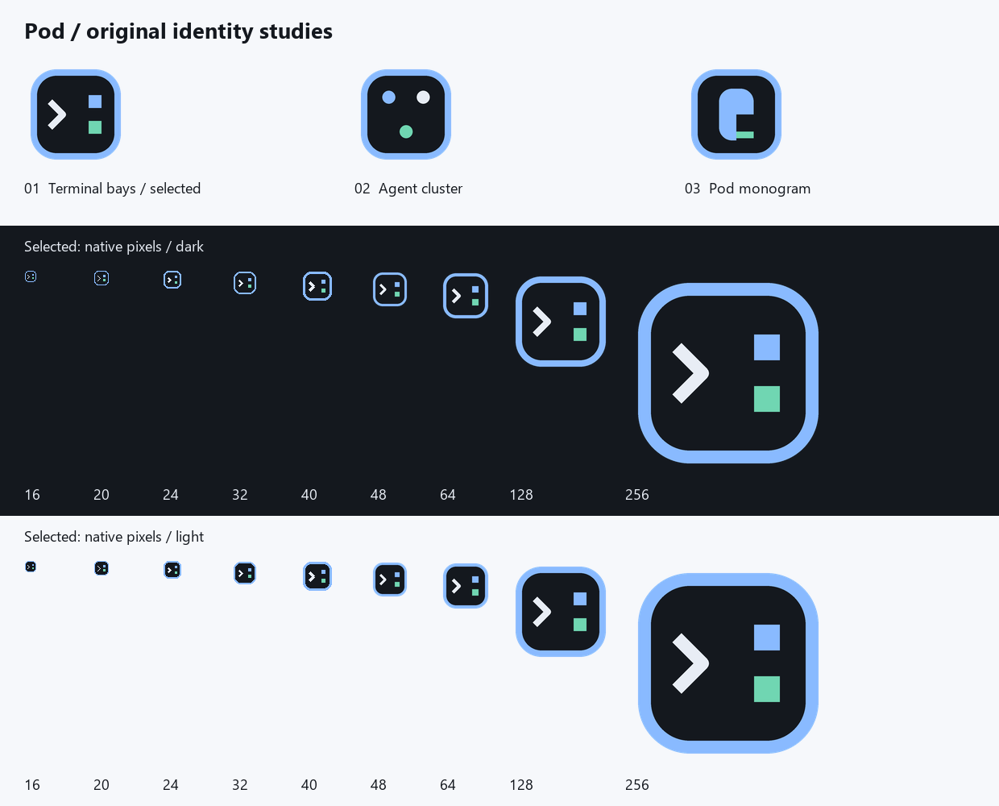

# Pod UI 디자인 언어 v1 — 구현 기준

작성: 2026-11-08 · 대상: Windows 네이티브 GPUI 앱 · 상태: D1 구현용 제안

Pod는 **작업 목록은 조밀하게, 현재 터미널은 넓게, 사람의 응답이 필요한 상태는 명확하게** 만든다. 무채색 면의 계층과 일관된 행 정렬을 기본으로 하고, `Repository > Task > Terminal` 구조와 독자적인 청회색 팔레트를 쓴다. 이 문서는 Pod 자체의 디자인 명세이며 다른 제품의 코드·이미지·CSS·아이콘을 가져오지 않았다.

## 0. 범위와 읽는 법

- **O(관찰)**: 공개 라이브러리 소스·문서에서 확인한 사실. **I(해석)**: 관찰에서 도출한 디자인 판단. **P(제안)**: Pod가 새로 정한 값과 동작. **U(미확인)**: 아직 판단할 수 없는 사항.
- 선행 문서: [기획 §4.2(5), §5.1, §9](01-plan.md), [GPUI 스파이크](02-ui-spike-notes.md). 기획 초안의 Monaco 표기는 현행 GPUI 결정에 맞춰 `gpui-component` editor/diff로 해석한다.
- §1–§3은 공개본에서 제외한 조사 메모 자리다. 아래 절 번호(§4 이후)는 다른 문서와 코드가 참조하므로 그대로 둔다.

### 참고 자료

| ID | 출처 | 범위 |
|---|---|---|
| E12 | `gpui-component-0.9.0/src/theme/` 의 `theme_color.rs`, `mod.rs`, `motion.rs` (crates.io 소스) | 0.9.0의 실제 필드와 API O |
| E13 | [Lucide 공식 라이선스](https://lucide.dev/license) | ISC 및 Feather 유래 아이콘의 MIT 고지 O |

## 1–3. (공개본에서 제외)

다른 제품 화면에 대한 조사 메모는 공개 저장소에 포함하지 않는다. Pod의 값은 모두 §4 이후에 독자적으로 정의한다. 정돈된 화면을 위해 Pod가 따르는 원칙:

1. **색보다 면의 차이**: sidebar/chrome/surface는 서로 다른 무채색 명도로 구분하고, 상태와 링크 외의 색 면적은 작게 둔다. 큰 컬러 카드와 매 행의 테두리를 피한다.
2. **밀도에 규칙이 있다**: 정수 높이(24/28/32/36px)와 4px 간격을 반복한다. 한글 가독성을 위해 기본 목록 글자는 13px.
3. **한 행에서 제목이 먼저 읽힌다**: 제목 > branch/model/time 계층. ellipsis를 쓰되 이름의 시작과 상태는 보존한다.
4. **경계와 그림자의 역할이 다르다**: dock에는 1px border, popover/toast/drag preview에만 shadow.
5. **상호작용은 작은 변화**: active와 hover 배경, focus ring, 짧은 transition, reduced-motion 대응.
6. **색만으로 상태를 표현하지 않는다**: 상태마다 형태와 텍스트를 함께 제공하고 focus ring을 없애지 않는다.

## 4. Pod design language v1 (P)

### 4.1 원칙과 밀도

- **현재 작업이 중심**: 화면의 가장 큰 면은 터미널. sidebar는 작업 선택, right panel은 선택한 작업 설명에 집중한다.
- **중립 면 + 한 개의 파란 accent**: 파랑은 선택·focus·일반 실행. 주황은 응답 필요, 녹색은 성공, 붉은색은 오류에 제한한다.
- **색 + 형태 + 문구**: 상태색을 끄거나 회색조로 봐도 구분된다. 텍스트 tooltip만으로 중요한 대기를 숨기지 않는다.
- **4px rhythm**: padding/gap의 기준은 4. 2px는 icon/text의 미세 간격과 border 주변에만 사용한다.
- **키보드와 한글이 기본**: 기본 UI 13px/20px, 최소 보조 글자 12px/16px. 중요한 상태를 10px로 줄이지 않는다. focus ring은 항상 2px.
- **지속성은 화면에 드러나게**: UI 연결 종료와 프로세스 종료를 구분한다. 재접속 중에는 마지막 상태를 흐리게만 만들지 않고 `연결 끊김 · 마지막 확인 …`를 표시한다.

기본 density는 compact. titlebar 36, tabbar 32, terminal header 28, statusbar 24, tree row 32, 작은 icon button hit area 28×28 logical px다. comfortable는 tree row/control만 36으로 키우며 terminal cell 크기는 별도 설정이다. sidebar 폭 256(최소 224/최대 360), inspector 304(최소 272/최대 420), 중앙 최소 480을 권장한다. 작은 창에서는 우측 패널부터 접고, 그 다음 sidebar를 overlay로 전환한다. 최소 지원 창 800×600 logical px; 150% 배율에서도 physical px를 직접 레이아웃에 쓰지 않는다.

### 4.2 독자 색 토큰

모든 hex는 sRGB, 끝의 두 자리는 alpha다. `text.muted`는 읽어야 하는 보조 정보이며 disabled와 구분한다. border.subtle은 면 분리용이고 입력/포커스의 필수 경계에는 border.control/ring을 쓴다.

| Pod token | Dark | Light | 용도 |
|---|---|---|---|
| `bg.canvas` | `#14181E` | `#F6F8FB` | 앱 바탕 |
| `bg.chrome` | `#1B2129` | `#EDF1F6` | sidebar/titlebar/statusbar |
| `bg.surface` | `#202833` | `#FFFFFF` | 내용/설정 패널 |
| `bg.raised` | `#293340` | `#FFFFFF` | dialog/popover/toast |
| `bg.hover` | `#303D4D` | `#E3EAF4` | 중립 hover |
| `bg.pressed` | `#3B4B5E` | `#D4DEED` | 중립 pressed |
| `bg.selected` | `#263F5E` | `#DDEBFC` | 목록 선택, 탭 선택 |
| `border.subtle` | `#354150` | `#D7DEE8` | pane 구분 |
| `border.control` | `#73849B` | `#7B8BA1` | 입력·명시적 조작 경계 |
| `text.primary` | `#E8EDF5` | `#202B3B` | 본문/선택 제목 |
| `text.secondary` | `#B7C3D4` | `#475970` | 경로·보조 제목 |
| `text.muted` | `#A5B3C7` | `#58687F` | 메타/설명; D3 선택/hover 배경 AA 보정 |
| `text.disabled` | `#66758B` | `#99A5B6` | 실제 disabled 전용 |
| `accent.fg` / `focus.ring` | `#89BAFF` | `#235FA8` | 링크/선택 테두리/working |
| `action.primary.bg` | `#3374C6` | `#2464AC` | 주요 CTA |
| `action.primary.hover` | `#2D69B5` | `#1E5798` | CTA hover |
| `action.primary.pressed` | `#255B9D` | `#194B85` | CTA pressed |
| `action.primary.fg` | `#FFFFFF` | `#FFFFFF` | CTA 글자 |
| `success.fg` | `#70D6B2` | `#136C53` | done/check |
| `success.bg` | `#183D33` | `#E2F3EC` | 성공 안내 면 |
| `warning.fg` | `#F2C078` | `#865100` | blocked 전반 |
| `warning.bg` | `#41331E` | `#FFF1DA` | 응답 필요 안내 면 |
| `danger.fg` | `#FF9DA7` | `#AD2940` | 오류/파괴적 action label |
| `danger.bg` | `#462630` | `#FBE8EC` | 오류 면 |
| `info.fg` | `#89BAFF` | `#235FA8` | 일반 정보 |
| `info.bg` | `#223B57` | `#E4EFFC` | 정보 면 |
| `overlay.scrim` | `#080D1680` | `#18253B40` | modal 외부 dim |
| `terminal.bg` | `#11161D` | `#FCFDFE` | 터미널 기본 바탕 |
| `terminal.fg` | `#E0E8F2` | `#243246` | VT default foreground |
| `terminal.selection` | `#304F73` | `#CFE2F8` | VT 선택 면 |
| `terminal.cursor` | `#B8D4FF` | `#235FA8` | caret; 위 glyph는 terminal.bg |

상태 배지는 `*.bg` 위 `*.fg` 텍스트/아이콘, 일반 목록에서는 배경 없이 `*.fg` 아이콘+`text.primary` label이다. primary 버튼의 흰 글자와 muted 본문은 D1에서 각 실제 배경 대비 4.5:1 이상, focus/필수 control 경계는 3:1 이상을 검증한다. 반투명 면을 본문 뒤에 쓰지 않아 배경에 따른 대비 변동을 줄인다. accent와 warning의 밝기를 상태의 심각도 순위로 해석하지 않는다.

D0에서 위 불투명 sRGB 값의 상대 휘도 대비를 계산했다. canvas/chrome/surface/raised 네 배경 중 muted의 최저값은 dark **6.01:1**, light **4.64:1**이고 control border는 **3.35:1 / 3.06:1**이다. semantic 배지 fg/bg 네 쌍의 최저값은 **5.75:1 / 5.51:1**, primary 버튼 흰 글자와 기본/hover/pressed 배경의 최저값은 **4.71:1 / 6.01:1**이다. 이는 팔레트의 산술 검증이며 실제 glyph 크기·anti-aliasing·focus 상태·alpha 합성·색각 시뮬레이션 검증을 대신하지 않는다.

ANSI 16/256색은 터미널 계약이며 `ThemeColor.red` 등을 자동으로 재사용하지 않는다. 앱 theme를 바꿔도 프로세스가 지정한 truecolor 출력은 보존한다. D1에서 별도 `TerminalPalette`와 기본/밝은 ANSI 16색 fixture를 확정한다.

### 4.3 간격·반경·타이포·elevation·motion

| 분류 | Pod 토큰/값 | 적용 |
|---|---|---|
| spacing | `space.0/1/2/3/4/6/8/12 = 0/4/8/12/16/24/32/48px`, `space.half=2px` | 전체 레이아웃 |
| tree indent | 16px/단계 | repo 0, task 16, terminal 32; 깊은 terminal은 펼치기 |
| radius | none 0, small 4, control 6, panel 8, overlay 12, pill 999px | tab 4, 버튼 6, floating dialog 12; 도킹 pane 외곽은 0 |
| UI font | Windows `Segoe UI Variable Text` → `Segoe UI`; 한글 `Malgun Gothic` → `Noto Sans CJK KR`가 설치된 경우 | OS fallback을 테스트; 웹폰트 다운로드 없음 |
| mono font | `Cascadia Mono` → `Consolas`; 한글 `Malgun Gothic` fallback | ligature 기본 off; 셀 advance 기준 별도 측정 |
| type.caption | 12px / 16px / 400 | statusbar, shortcut, count |
| type.body | 13px / 20px / 400 | tree/설정/팔레트 |
| type.label | 13px / 20px / 600 | group·field label |
| type.subtitle | 15px / 24px / 600 | 패널 제목 |
| type.title | 20px / 28px / 600 | dialog/empty heading |
| type.display | 28px / 36px / 600 | 첫 진입만 |
| terminal text | 기본 14px, line-height는 측정된 셀에서 시작(목표 20px) | 고정 비율을 VT cell에 강제하지 않음 |
| border/focus | divider 1px, focus ring 2px + offset 2px | 물리 pixel snapping 별도 |
| elevation.0 | shadow 없음 | dock, tree, tab, statusbar |
| elevation.1 | x0 y4 blur12 spread0, dark `#00000040` / light `#2030471F` | menu/tooltip |
| elevation.2 | x0 y12 blur32 spread0, dark `#00000066` / light `#2030472E` | palette/dialog/toast |
| motion.instant | 0ms | 키 입력, selection, resize, terminal paint |
| motion.fast | 100ms | hover/focus visual |
| motion.normal | 160ms | toast/menu opacity |
| motion.slow | 220ms | panel reveal; layout 위치가 확정된 뒤 opacity |
| easing | enter `(0.16,1,0.3,1)`, exit `(0.4,0,1,1)`, move `(0.2,0,0,1)` | overshoot 없음 |
| activity | 1,000ms linear spinner, 보이는 working만 | reduced-motion이면 정적 arc+문구 |
| reduced motion | 모든 transition 0ms, pulse/slide 없음 | 사용자가 OS 설정 또는 앱 설정에서 선택 |

`font_family`는 CSS fallback 문자열을 그대로 넣는 API가 아니다. 실제 설치 폰트를 선택하고 GPUI의 fallback 경로가 한글·emoji·box drawing을 처리하는지 D1에서 확인한다. 서체 자체를 repo에 추가하는 경우 별도 라이선스 검토가 필요하다.

### 4.4 상태 체계: 색각 차이와 불확실성 대응

| Domain state | 16px 형태/아이콘과 항상 가능한 문구 | 색 | 세부 규칙 |
|---|---|---|---|
| idle | 빈 원 `Circle` · 대기 | text.muted | 실행 중 프로세스가 입력을 기다리는 상태 |
| working | 끊어진 원호 `LoaderCircle` · 작업 중 | info.fg | 정지된 프레임에서도 빈 원과 구분 |
| blocked.permission | 방패 `ShieldQuestion` · 승인 필요 | warning.fg | 버튼 `요청 보기`; 자동 승인 없음 |
| blocked.question | 말풍선 `MessageCircleQuestion` · 답변 필요 | warning.fg | 질문 preview와 원래 terminal로 이동 |
| blocked.auth | 자물쇠 `LockKeyhole` · 로그인 필요 | warning.fg | 인증 action 설명, credential 자체는 표시하지 않음 |
| blocked(이유 없음) | 삼각형 `TriangleAlert` · 확인 필요 | warning.fg | reason unknown을 질문/승인으로 추측하지 않음 |
| done | 체크 원 `CircleCheck` · 완료 | success.fg | 프로세스가 계속 살아 있어도 가능 |
| error | 팔각형 `OctagonX` · 오류 | danger.fg | 메시지와 재시도/로그 액션 |
| unknown | 물음표 원 `CircleHelp` · 상태 미확인 | text.secondary | 성공이나 idle로 대체하지 않음 |
| exited | 네모 `Square` + 작은 exit 표시 · 종료 | text.muted | lifecycle 상태; code/마지막 agent state는 detail에 분리 |

색상만의 colorblind-safe 보장은 하지 않는다. **각 silhouette + 한국어 label + accessible name**의 중복 표현으로 deuteranopia/protanopia/tritanopia와 회색조에서도 기능이 유지되게 설계한다. 좁은 tab에서는 icon만 보일 수 있지만 focus/hover tooltip과 AccessKit name에 전체 상태를 제공한다. 최소 icon 14px, 기본 16px, 2px stroke; ASCII glyph는 아래 wireframe 설명용이며 제품에서는 SVG를 쓴다.

상태 tooltip은 `승인 필요 · Claude · hook · 2초 전`처럼 출처(hook/OSC/heuristic)·freshness를 표시한다. confidence가 낮으면 `추정`을 붙인다. **UI connection stale은 unknown으로의 도메인 변경과 별개**다. 마지막 상태 옆 연결 해제 표식을 보여주고 working spinner는 멈춘다. `exited(code≠0)`는 종료 아이콘 옆 `실패 종료 (1)`와 danger label로 표현하고 기존 agent.error와 혼동하지 않는다.

Repo/Task 집계는 `작업 3 · 응답 1`처럼 이름 붙인 숫자를 사용한다. 하위 terminal을 한 번씩만 센다. 우선 표시 상태는 `error > blocked > working > unknown > idle`; 모든 대상이 done이면 완료, 모두 exited이면 종료다. done과 exited 혼합은 `완료 2 · 종료 1`로 남기고 일괄 성공으로 합치지 않는다. 응답 badge는 최대 `99+`, 실제 수는 accessible name/tooltip에서 제공한다. 상태 갱신 때문에 tree를 자동 재정렬하거나 현재 focus를 옮기지 않는다.

### 4.5 gpui-component 0.9 연결 계약

E12의 `ThemeColor`는 실제 `Hsla` 필드다. `Theme`에는 `colors`, `font_family`, `font_size`, `mono_font_family`, `mono_font_size`, `radius`, `radius_lg`, `shadow`, `motion`이 있다. 또한 `ThemeTokens`/`ThemeToken`이 color와 renderable background를 보관하며 reconcile 로직이 존재한다. **Pod 토큰이 원본이고 아래 adapter는 종속 출력**이다. 기본 dark/light를 복제해 명시 매핑하고, 전체 struct를 임의의 0값으로 만들지 않는다. Theme change 이후 adapter를 다시 적용하고 notifications/repaint를 포함하는 정확한 mutation 경로는 D1에서 확인한다.

| 실제 `ThemeColor` 필드 | Pod 원본 토큰 / 정책 |
|---|---|
| `background`, `foreground` | bg.canvas, text.primary |
| `border`, `window_border` | border.subtle; window_border는 소스 주석상 Linux 전용이므로 Windows 외곽 제어 수단이 아님 |
| `input`, `ring`, `caret` | border.control, focus.ring, accent.fg (`input`은 입력 배경이 아니라 border) |
| `accent`, `accent_foreground` | bg.hover, text.primary (`accent`는 주 CTA색이 아니라 item hover 용도) |
| `primary`, `primary_hover`, `primary_active`, `primary_foreground` | action.primary.bg/hover/pressed/fg |
| `button_primary`, `button_primary_hover`, `button_primary_active`, `button_primary_foreground` | 위 primary 4종을 명시적으로 동일 매핑 |
| `button`, `button_hover`, `button_active`, `button_foreground` | bg.surface, bg.hover, bg.pressed, text.primary |
| `secondary`, `secondary_hover`, `secondary_active`, `secondary_foreground` | bg.surface, bg.hover, bg.pressed, text.secondary |
| `button_secondary`, `button_secondary_hover`, `button_secondary_active`, `button_secondary_foreground` | secondary와 동일 |
| `muted`, `muted_foreground`, `skeleton` | bg.chrome, text.muted, bg.hover; disabled는 Pod 별도 token |
| `popover`, `popover_foreground`, `overlay` | bg.raised, text.primary, overlay.scrim |
| `sidebar`, `sidebar_foreground`, `sidebar_border` | bg.chrome, text.primary, border.subtle |
| `sidebar_accent`, `sidebar_accent_foreground`, `sidebar_primary`, `sidebar_primary_foreground` | bg.hover, text.primary, bg.selected, text.primary |
| `list`, `list_even`, `list_head`, `list_hover`, `list_active`, `list_active_border` | bg.surface, bg.surface(줄무늬 없음), bg.chrome, bg.hover, bg.selected, accent.fg |
| `tab`, `tab_bar`, `tab_bar_segmented`, `tab_foreground` | bg.chrome, bg.chrome, bg.chrome, text.secondary |
| `tab_active`, `tab_active_foreground` | bg.surface, text.primary; active underline은 Pod accent.fg |
| `title_bar`, `title_bar_border`, `status_bar`, `status_bar_border` | bg.chrome, border.subtle, bg.chrome, border.subtle |
| `table`, `table_even`, `table_head`, `table_foot`, `table_row_border` | bg.surface, bg.surface, bg.chrome, bg.chrome, border.subtle |
| `table_head_foreground`, `table_foot_foreground`, `table_hover`, `table_active`, `table_active_border` | text.secondary, text.secondary, bg.hover, bg.selected, accent.fg |
| `success`, `success_foreground`, `success_hover`, `success_active` | success.bg, success.fg, success.bg, success.bg |
| `warning`, `warning_foreground`, `warning_hover`, `warning_active` | warning.bg, warning.fg, warning.bg, warning.bg |
| `danger`, `danger_foreground`, `danger_hover`, `danger_active` | danger.bg, danger.fg, danger.bg, danger.bg |
| `info`, `info_foreground`, `info_hover`, `info_active` | info.bg, info.fg, info.bg, info.bg |
| `button_success{,_foreground,_hover,_active}`, `button_warning{,_foreground,_hover,_active}`, `button_danger{,_foreground,_hover,_active}`, `button_info{,_foreground,_hover,_active}` | 해당 semantic의 bg/fg/bg/bg. D1에서는 이 네 variant를 비대화형 배지에 쓰지 않고, 버튼 hover에 별도 1px border/pressed inset을 적용; 색 변화만으로 상호작용을 전달하지 않음 |
| `link`, `link_hover`, `link_active` | accent.fg, accent.fg, accent.fg; underline으로 hover/active 표현 |
| `selection`, `drag_border`, `drop_target` | bg.selected, focus.ring, bg.selected |
| `scrollbar`, `scrollbar_thumb`, `scrollbar_thumb_hover` | bg.chrome, border.control, text.secondary |
| `progress_bar`, `slider_bar`, `slider_thumb` | accent.fg, accent.fg, text.primary |
| `switch`, `switch_thumb` | bg.pressed, text.primary; checked visual은 primary 매핑과 함께 D1 확인 |
| `accordion`, `group_box`, `group_box_foreground` | bg.surface, bg.surface, text.primary |
| `description_list_label`, `description_list_label_foreground` | bg.chrome, text.secondary |

표의 `{,_foreground,_hover,_active}`는 실제 필드 이름 네 개를 축약한 표기다. `chart_1..5`, `chart_bullish/bearish/grid`, `red/red_light`, `green/green_light`, `blue/blue_light`, `yellow/yellow_light`, `magenta/magenta_light`, `cyan/cyan_light`는 D1 초기 앱에서 사용하지 않으므로 **library의 해당 mode 기본값 유지**다. 이 값이 제품의 상태·terminal ANSI 값으로 새어 나오지 않게 한다.

`Theme.font_size=13px`, `mono_font_size=14px`, `radius=6px`, `radius_lg=12px`를 목표로 한다. E12 `MotionTokens`의 `duration_instant/fast/normal/slow`에는 0/100/160/220ms, easing에는 §4.3을 연결한다. `distance_short/medium`은 4/8px에 해당하는 rem, spring은 bounce 없이 설정하되 terminal/resize에는 사용하지 않는다. library가 radius/shadow의 파생 토큰을 제공하므로 모든 radius/shadow가 없다고 가정하지 않는다.

**Pod가 별도로 소유할 토큰/계약**: 상태 종류·blocked reason·confidence·staleness, source badge, text.secondary와 text.disabled의 구분, terminal ANSI/selection/cursor, row/tab/titlebar 높이, tree indent, icon stroke/hit area, focus offset, elevation별 shadow 명세, typography 역할별 line-height, toast timeout, z-order, reduced-motion 정책. `ThemeColor`에는 이 의미들이 없다. 레이어 순서는 content < dock chrome < popover < modal scrim < modal < modal 소유 toast이고, tooltip은 owner가 속한 레이어 안에 둔다.

## 5. 화면별 wireframe과 동작 (P)

표시 수치는 logical px이며 ASCII 폭은 비율 설명용이다. 예제 이름·경로·결과는 허구다. 미래 기능은 자리만 설계하고 D2에서 미구현 버튼을 활성화하지 않는다.

### 5.1 주 창: 작업과 병렬 terminal

```text
+--------------------------------------------------------------------------------------+
| Pod  [sidebar]  repo / 로그인 개선          [명령 검색 Ctrl+K]          [-] [□] [×] | 36
+------------------------+-------------------------------------------+-----------------+
| 저장소         [+ 작업] | [◔ Codex ×] [> PowerShell ×] [+] [split]   | 상태  Checks ... | 32
| [검색 / 필터         ]  +----------------------+--------------------+-----------------+
| v ▣ sample-api     2    | ◔ 구현 · Codex  [...] | △ 검증 · Claude [...]| 로그인 개선     |
|   v 로그인 개선        +----------------------+--------------------+ branch: pod/auth|
|     작업 1 · 응답 1     | > 변경 사항 분석 중… | 승인 필요          | 터미널 3        |
|     ◔ Codex   작업 중   |                      | 파일 수정 요청      | ◔ 구현          |
|     △ Claude  승인 필요|                      | [요청 보기]         | △ 검증          |
|     ○ shell   대기     |                      |                    | ○ shell         |
|   > 문서 수정  ✓ 완료  |                      |                    |                 |
| > ▣ sample-web     1    |                      |                    | source: hook    |
|                        |                      |                    | 확인: 2초 전    |
|                        |                      |                    |                 |
| [설정] [도움말]        |                      |                    | [패널 닫기]     |
+------------------------+----------------------+--------------------+-----------------+
| ◔ 작업 1   △ 응답 1   오류 0     [로컬 연결됨]             [포트 2]   [알림]       | 24
+--------------------------------------------------------------------------------------+
         256                      flex (최소 480)                    304 / 접기
```

타이틀바 검색은 drag에서 제외하고 빈 부분만 창을 움직인다. Windows minimize/maximize/restore/close, double-click maximize, Snap/resize hit-test는 네이티브 의미를 보존한다. 접근 가능한 이름과 키보드 동작을 제공한다. titlebar의 작업 경로는 현재 focus한 pane과 동기화한다.

Sidebar는 repo header 32px, task title 32px, 확장 시 branch/집계 보조행 20px, terminal row 32px. 이름은 ellipsis, 전체 경로는 tooltip. 상태 badge 폭은 고정해 갱신 시 이름이 흔들리지 않게 한다. 선택은 bg.selected+좌측 2px accent, hover는 bg.hover, focus는 별도 ring이다. 키보드 Up/Down 이동, Left/Right 접기·펼치기, Enter 열기, context menu는 keyboard로 접근한다. 실제 작업 삭제와 화면 닫기를 다른 action으로 둔다.

탭은 120–220px 권장, overflow는 `열린 탭` 메뉴로 보내며 active tab은 보이게 scroll한다. 닫기 버튼은 hover 또는 keyboard focus에 나타나되 28px hit area를 예약한다. 닫기는 뷰 detach이고 종료는 별도 메뉴/확인이다. Pane header의 상태·이름·더보기만 상시 표시한다. 상태 배지는 선택 terminal의 원본 상태를 사용하고 root/child 관계를 제목에 과다 노출하지 않는다.

터미널에는 content padding 8px, split 경계 1px+resize hit slop 6px. 상태 변화에 따라 출력 영역을 재배치하지 않고 응답 banner는 header 아래 고정 슬롯 또는 overlay로 띄운다. 재접속 banner는 `연결 재시도 중 · 마지막 출력 보관됨 [다시 시도]`로 표시한다. right inspector는 처음에는 닫혀 있고 `상태`만 D2 범위; Checks/PR/Notes는 후속 기능이 준비된 시점에 노출한다.

### 5.2 Ctrl+K command / jump palette

```text
            +----------------------------------------------------------+
            | ⌕ 작업, 터미널 또는 명령 검색                         Esc | 44
            +----------------------------------------------------------+
            | 최근                                                     |
            | ◔ 로그인 개선 / Codex        sample-api · 작업 중         | 36
            | ○ PowerShell                 sample-api · 대기            |
            | 명령                                                     |
            | + 새 작업 만들기                              Ctrl+N      |
            | ▣ 저장소 열기                                             |
            | ⚙ 설정 열기                                   Ctrl+,      |
            +----------------------------------------------------------+
            | ↑↓ 이동   Enter 열기   Esc 닫기                 결과 5개  | 28
            +----------------------------------------------------------+
```

폭 640(창 좌우 최소24), 높이 최대 min(480, 가용높이−96), 화면 상단 20% 부근. 입력 44px/14px, 결과 36px/13px, 그룹 label 12px. 기본은 최근 작업/terminal+command, `>` prefix는 명령으로 좁힌다. 결과의 repo/task 경로와 상태를 한 줄 보조 정보로 제공한다. fuzzy highlight는 weight와 underline, selected row는 bg.selected. 검색 결과 0이면 `일치하는 항목이 없습니다`와 `[검색 지우기]`; 연결 실패면 `[다시 시도]`를 별도로 표시한다.

Ctrl+K는 명시적인 앱 전역 기본 단축키이고 설정에서 바꿀 수 있다. 터미널의 Ctrl+K를 쓰는 사용자를 위해 command registry의 `현재 터미널에 Ctrl+K 보내기` 및 terminal 우선 shortcut 모드를 제공할 설계 여지를 둔다. IME 조합 중 Enter는 결과 실행에 사용하지 않는다. Esc는 원래 focus로 복귀, 열 때 query에 focus, 선택 결과는 stable ID로 유지한다.

### 5.3 새 작업 dialog

```text
          +--------------------------------------------------------+
          | 새 작업                                            [×]|
          | 별도 작업 공간에서 에이전트를 시작합니다.               |
          +--------------------------------------------------------+
          | 저장소       [sample-api                           v]  |
          | 작업 이름    [로그인 개선                            ]  |
          | 기본 브랜치  [main                                 v]  |
          | 에이전트     [Codex                                v]  |
          | 요청         [로그인 오류를 재현하고 수정해 주세요.    ]  |
          |              [                                     ]  |
          | 작업 위치    .../worktrees/login-fix                    |
          | 브랜치       pod/login-fix                             |
          | > 고급 설정                                            |
          +--------------------------------------------------------+
          |                                  [취소] [작업 만들기]  |
          +--------------------------------------------------------+
```

폭 560, padding 24, field gap16, label 위 간격8, input 높이36. repo는 현재 선택에서 초기화하되 사용자가 바꿀 수 있다. slug/branch/path는 서버 규칙에 따른 preview이며 한글 이름으로 잘못된 branch를 추측해 확정하지 않는다. 중복/유효하지 않은 값은 해당 field 아래 문구+icon, 생성 실패는 입력 보존+상단 오류 요약. 제출 중 버튼 disabled+`만드는 중…`, 성공 후 해당 task로 focus. 중복 제출은 막는다. Escape/취소는 작성 내용을 확인하는 정책을 일관되게 적용하고, 클릭만으로 기존 작업을 덮어쓰지 않는다.

### 5.4 toast와 알림

```text
                                              +-----------------------------------+
                                              | ✓ 작업을 만들었습니다          × |
                                              | 로그인 개선       [작업 열기]    |
                                              +-----------------------------------+
                                              +-----------------------------------+
                                              | △ 검증 에이전트의 응답이 필요해요|
                                              | 승인 요청 1개     [요청 보기]    |
                                              +-----------------------------------+
```

오른쪽 아래, statusbar 위 16px, 폭360(창−32 이내), gap8, padding16. icon16 + 제목13/600 + 설명12/16. 일반 성공 5초, 정보 7초, hover/focus 시 타이머 정지. 오류/응답 필요는 자동 소멸하지 않고 알림 센터에 남긴다. toast를 닫아도 blocked 자체가 해결되지 않는다. 동시에 3개 이하, 같은 task/event는 갱신하고 나머지는 `알림 N개`. live announcement는 일반 polite, 즉시 대응 오류만 assertive에 준하는 AccessKit 경로를 검증한다. modal 중 발생한 다른 작업 toast가 modal focus를 가로채지 않게 한다.

### 5.5 empty state와 최초 진입

```text
+---------------------------------------------------------------------------+
| Pod                                                   [-] [□] [×]        |
|                                                                           |
|                            [FolderOpen 32]                                |
|                      첫 저장소를 열어 보세요                              |
|             작업마다 공간을 나누고 터미널을 함께 관리합니다.               |
|                                                                           |
|                           [저장소 열기]                                   |
|                       Ctrl+K로 명령 찾아보기                              |
|                                                                           |
+---------------------------------------------------------------------------+
```

중앙 내용 max-width420, title20/28, 설명13/20, illustration 없이 Lucide icon. 저장소는 있으나 task가 없으면 `이 저장소의 첫 작업 만들기 [+ 새 작업]`; task에 terminal이 없으면 `[터미널 시작]`; 검색 결과 없음·연결 실패·삭제된 항목은 각각 다른 문구와 action이다. 앱 초기 로딩에는 skeleton과 설명을 사용하며 잠깐 empty CTA가 번쩍이지 않게 한다. 온보딩 투어·feature wall·mascot은 D2 범위 밖이다.

### 5.6 설정 화면

```text
+----------------------+----------------------------------------------------+
| 설정                 | 모양                                               |
| [설정 검색         ] |                                                    |
| > 모양               | 테마              [시스템] [다크] [라이트]         |
|   터미널             | 밀도              [기본 v]                          |
|   단축키             | UI 글자 크기      [13 px]                           |
|   알림               | 애니메이션 줄이기 [시스템 따르기 v]                 |
|   연결               |                                                    |
|   정보               | 미리보기                                           |
|                      | +----------------------------------------------+   |
|                      | | ◔ 작업 중    △ 승인 필요   ✓ 완료   ⛔ 오류 |   |
|                      | | 선택한 작업           [기본 버튼] [주요 버튼]|   |
|                      | +----------------------------------------------+   |
|                      |                                      [기본값 복원] |
+----------------------+----------------------------------------------------+
```

설정은 일반 탭으로 열고 category 폭192, content max-width720, 섹션 gap24. 즉시 저장되는 항목은 `자동 저장됨` 피드백, 저장 실패 시 이전 값 유지+오류 표시. 테마/글자 크기를 변경해도 focus/스크롤을 유지한다. terminal font/ANSI palette/line-height는 모양과 별도 category. 단축키 검색과 충돌 표시, 알림에서 소리/중요 이벤트, 연결에서 로컬 daemon 상태를 제공한다. 준비되지 않은 remote 기능은 enabled UI로 약속하지 않는다.

## 6. 아이콘 세트와 라이선스

**Lucide를 권장한다(P).** 24×24 viewBox, 2px stroke, rounded cap/join을 기준으로 UI에 16px, toolbar에 18px, empty state에 32px로 사용한다. 기본 text.secondary, 선택 text.primary, 상태만 semantic 색이다. provider 로고 대신 terminal/bot+이름을 쓰면 초기 저작권·브랜드·대비 관리가 단순해진다.

[공식 라이선스](https://lucide.dev/license)는 ISC이고 Feather 유래 일부 아이콘에는 MIT 고지가 추가된다(O). 둘 다 허용 범위다. D1은 upstream release/commit을 고정하고 채택 SVG와 **ISC + 해당 MIT copyright/license**를 함께 기록한다. Lucide 파일은 upstream에서 직접 조달한다. D0에서는 asset을 추가하지 않는다.

| 범위 | 필요한 Lucide 식별자 |
|---|---|
| 탐색/작업 | `PanelLeft`, `PanelRight`, `FolderOpen`, `FolderGit2`, `GitBranch`, `GitPullRequest`, `ListTree`, `Layers`, `Plus`, `Search`, `Filter`, `ChevronRight`, `ChevronDown`, `ArrowLeft`, `ArrowRight` |
| terminal/tab | `Terminal`, `Bot`, `Columns2`, `Rows2`, `Maximize2`, `Minimize2`, `X`, `Ellipsis`, `Copy`, `ExternalLink`, `RefreshCw`, `Square` |
| 상태 | `Circle`, `LoaderCircle`, `ShieldQuestion`, `MessageCircleQuestion`, `LockKeyhole`, `TriangleAlert`, `CircleCheck`, `OctagonX`, `CircleHelp` |
| shell chrome | `Minus`, `Maximize`, `Copy`(restore 후보), `Settings`, `Keyboard`, `Sun`, `Moon`, `Monitor`, `Bell`, `BellOff`, `Info` |
| 데이터/연결/후속 review | `Check`, `FileText`, `FileDiff`, `GitCompareArrows`, `ClipboardCheck`, `StickyNote`, `Server`, `Plug`, `Unplug`, `WifiOff`, `Trash2`, `LogOut` |

식별자는 현행 Lucide의 명명 관례를 따른 요구 목록이며, D1의 pinned asset 버전에서 alias/존재를 확인한다. Windows caption controls는 그림만 비슷하게 그리기보다 OS/GPUI가 제공하는 의미와 hit-test를 우선한다. 작은 원·선 등 primitive로 충분한 상태는 직접 벡터로 그려도 되지만 같은 visual contract를 지킨다.

## 7. D1 / D2 구현 우선순위와 완료 기준

아래는 1인 집중 작업 기준 engineering day(1일≈6시간) 추정이며 빌드/리뷰/한글·DPI 검증 포함, daemon/API 기능 추가·전체 D3는 제외다. 선행 UI 골격 병합 이후 진행한다. 범위를 작게 나눠 각 단계가 독립적으로 review 가능하게 한다.

### D1 — `pod-ui` 크레이트: 약 6–9일

| 우선 | 작업 | 산출·완료 기준 | 노력 |
|---|---|---|---|
| P0 | token 구조 + dark/light + gpui-component adapter | §4 역할을 단일 source로 정의, actual ThemeColor 필드 컴파일 검증, theme 전환 일관성 | 1–1.5일 |
| P0 | font/spacing/radius/icon wrapper | 13px 한글 baseline, 16px icon, focus/hit area, upstream license 목록 | 0.5–1일 |
| P0 | `StatusBadge`, `StatusSummary`, `TreeRow`, `IconButton` | 모든 상태/blocked reason/unknown/exited/stale fixture, selection+hover+focus 조합 | 1–1.5일 |
| P0 | dialog/palette/list/toast/empty 공용 틀 | focus 소유/복귀, keyboard, disabled/loading/error, 좁은 창 대응 | 1.5–2일 |
| P1 | theme gallery와 QA fixture | 두 테마×100/150%×한글/긴 제목; 색 대비·회색조·reduce motion 검증 | 1–1.5일 |
| P1 | 통합 안내·기본 terminal palette 확정 | UI theme와 VT palette 경계, 공용 API 예제, 미사용 library default 목록 | 0.5–1일 |

검증에는 상태→형태/label 매핑, theme 대비, keyboard focus 왕복처럼 실제 의미를 보호하는 테스트를 둔다. 모든 색 literal을 복제하는 snapshot unit test는 피한다. Gallery의 **일관된 fixture 스크린샷**을 D1 결과로 남기며 사용자 작업을 샘플로 쓰지 않는다.

### D2 — `pod-app` 적용: 약 8–12일

| 우선 | 작업 | 산출·완료 기준 | 노력 |
|---|---|---|---|
| P0 | root theme + custom titlebar/statusbar | Windows drag/maximize/snap/resize, 연결 상태 명확, 테마 전환 유지 | 1–1.5일 |
| P0 | repo > task > terminal sidebar | 실제 API adapter, stable selection, counts/blocked reason, 가상화, 접기 복원 | 1.5–2.5일 |
| P0 | dock/tab/terminal chrome | 닫기 vs 종료 분리, split focus, reconnect banner, 제목 overflow, 기존 VT 성능 보존 | 1–1.5일 |
| P0 | Ctrl+K palette + command registry | jump와 command 통합, IME Enter 안전, shortcut conflict 설정 경로 | 1–1.5일 |
| P0 | 새 task dialog + empty/loading/error | 서버 validation/실패 입력 보존/중복 생성 방지, 최초 저장소 경로 | 1–1.5일 |
| P1 | toast + 알림 요약 + 상태 inspector | event 중복 제거, 대기 알림 보존, source/freshness 표시 | 1–1.5일 |
| P1 | 설정 및 전체 회귀 | theme/font/density/reduced motion 저장, 긴 한글·배율·키보드 경로 검증 | 1.5–2일 |

의존성: sidebar/task 생성은 P3 API, 실제 상태는 P1b, terminal 연결은 P2에 의존한다. API가 아직 없으면 fixture gallery까지 진행하고 제품에서 가짜 실시간 상태를 표시하지 않는다. Checks/PR/Notes, floating panels, remote 계정·사용량, 외부 agent brand asset은 D2 다음 기능 단계로 미룬다.

### D1에서 D2로 넘기는 gate / D3로 넘길 항목

- D1 gate: 두 테마의 버튼/목록/입력/focus가 식별 가능, 실제 배경 대비 측정, 모든 상태의 회색조 구별, 한글 IME/글꼴 fallback, 150% 배율의 baseline·border·icon QA. 실패 항목은 D2에 넘기기 전에 수정한다.
- D2 gate: repo 열기→task 생성→terminal 이동→blocked 요청 찾기→다시 작업→완료 확인이 keyboard로 가능. 연결 끊김과 종료가 다른 상태로 표시됨. task 100개/terminal 300개 fixture에서도 리스트가 과도하게 느려지지 않음(수치 성능 기준은 기존 P2 측정과 함께 확정).
- D3: AccessKit/UIAutomation 실제 탐색, Narrator 알림, Windows high contrast, 100/125/150/200% 및 monitor 간 이동, 작은 창/긴 한국어/emoji, terminal cell alignment, pixel snapping, animation frame pacing, 스크린샷 회귀 기준 확정. 각 단계에서 필수 접근성 결함을 뒤로 미루지는 않는다.

### 확인하지 못한 사항과 후속 검증

1. Pod 제안은 아직 화면으로 렌더하지 않았다. 색 대비의 최종 합성 결과, 한글 fallback, AccessKit, reduced-motion 전달, Windows mixed-DPI, library semantic button variant의 실제 스타일은 D1/D2에서 검증해야 한다.

D0 산출은 이 문서 하나다.


## 10. D1 results (2026-11-08)

Added the Apache-2.0 `crates/pod-ui` library. Dark/light tokens are the source of truth for the actual gpui-component 0.9 ThemeColor adapter, spacing, radius, typography, elevation, motion and terminal defaults. `apply_theme` uses `Theme::change` then `Theme::update`, reconciling ThemeTokens/Base projection and refreshing windows; it also installs PodModal bindings. Fonts are selected from installed families, with Windows/GPUI Korean fallback. Icons are 16px, icon hit areas 28px, focus rings 2px with a 2px gap.

API: `StatusBadge`, `StatusSummary`, `TreeRow`, `IconButton`, `semantic_button`, `Frame` (Dialog/CommandPalette/List/Toast/Empty), `FocusReturn`, `modal_keyboard`, `ListSelection`, `toast_timeout`, and `TerminalPalette`. StatusBadge consumes `StatusSnapshot::display_state()` and preserves source, confidence, root/final state and running children. Exit code and stale connection are separate inputs. Summary deduplicates terminal IDs; UI priority is error > blocked > working > unknown > idle, intentionally different from engine aggregation. Mixed done/exited is not reported as all done. Semantic actions add hover borders and pressed insets; noninteractive status uses StatusBadge.

Only 14 used SVGs were independently downloaded from upstream Lucide **0.468.0**. ISC and Feather MIT notices are in `crates/pod-ui/THIRD-PARTY.md`. Existing deny.toml already allows ISC, so it was not changed. Unused chart/base colors and syntax defaults retain the library's mode defaults. TerminalPalette independently defines ANSI 16 and default VT foreground/background/cursor/selection; xterm 16-255 and explicit process truecolor/OSC overrides remain separate. The existing terminal renderer is unchanged.

### Contrast and behavior checks

Minimum ratios computed from the actual opaque sRGB tokens:

| Role | Dark | Light | Required |
|---|---:|---:|---:|
| muted / canvas, chrome, surface, raised | 6.013 | 4.645 | 4.5 |
| control border / same four surfaces | 3.352 | 3.060 | 3.0 |
| focus ring / same four surfaces | 6.414 | 5.655 | 3.0 |
| primary foreground / normal, hover, pressed | 4.714 | 6.011 | 4.5 |
| semantic foreground/background pairs | 5.751 | 5.514 | 4.5 |

Nine meaning tests cover every state/blocked kind's distinct shape and label, stale/exit/held-open metadata, child-blocked override, summary deduplication/mixed lifecycle, contrast thresholds, nested focus return and Tab wrap, ANSI boundaries, toast pause/persistence, stable list selection and suppression of activation during IME composition. A live GPUI dispatch check also passed initial focus, Tab trapping and Escape restoring the opener. Raw keydown did not override global Tab actions; contextual PodModal action bindings fixed the live failure.

The fixture-only gallery uses the release GUI subsystem and opens on the first secondary display by default. Options: `--light`, `--primary`, `--duration N`, `--dialog`, `--self-check`. API and execution guidance are in `crates/pod-ui/README.md`; DPI-aware capture, native IME harness and screenshot evidence are in `crates/pod-ui/qa/`.

### Validation

Workspace-wide release build and tests passed before the final modal/semantic fixture refinements; the changed crate was rechecked afterwards. All final checks exited 0, with zero pod-ui warnings. Final tails are in `qa/verification.txt`, earlier workspace tails in `qa/workspace-checks.txt`. Runs used the coordinator CPU gate, shared target `C:\ai\pod-target`, and four build jobs.

```text
cargo build -p pod-ui --release --all-targets
Finished `release` profile [optimized + debuginfo]
cargo test -p pod-ui --release -- --nocapture
test result: ok. 9 passed; 0 failed; 0 ignored; 0 measured; 0 filtered out
cargo clippy -p pod-ui --release --all-targets -- -D warnings
Finished `release` profile [optimized + debuginfo]
cargo deny check
advisories ok, bans ok, licenses ok, sources ok
```

The pre-existing podd missing-vendored-ConPTY warning (inbox fallback) and deny's unmatched ISC allowance advisory remain. SVG licenses are tracked separately from Cargo's package graph in THIRD-PARTY.

### D2 handoff

- Run `apply_theme` after `gpui_kit::init` and every appearance change. Give repeated rows stable parent IDs.
- Focus the opener before `FocusReturn::enter`; call `leave` on every dismiss path. Pass only enabled Tab stops to `modal_keyboard`. Toasts must not acquire focus automatically.
- Feed real IME composition state into `ListSelection::activation`; do not execute a command on composition-confirming Enter.
- Hosts own input entities, command registries, validation, toast timers/history/deduplication, tree expansion and settings persistence.
- Keep UI priority separate from engine aggregation. Stale connection preserves the last domain state and is distinct from exit.
- Add a palette injection boundary to the terminal renderer before applying TerminalPalette. Importing pod-ui alone does not replace existing hardcoded VT colors.
- Cargo generates the new workspace package's lock entry; Cargo.lock was excluded by this task's permitted file scope, so integration must update it.


### Visual evidence

Reviewed the actual DPI-aware gallery captures (fixture data only):

- Secondary display at **150% / 144 DPI**: `crates/pod-ui/qa/dark-144-secondary.png` and `light-144-secondary.png`; matching `-controls.png` captures show tree selection/disabled rows, semantic actions, switches and ANSI16.
- Every state in grayscale: matching `-grayscale.png` files in both themes. Shape and Korean label distinguish all blocked reasons, unknown, exited/failed exit, stale connection and held-open children.
- **100% / 96 DPI** comparison: `dark-96-primary.png` and `light-96-primary.png`. This used the primary display; the secondary was left at 150%, without changing Windows settings.
- Dialog frames: `dark-144-secondary-dialog.png` and `light-144-secondary-dialog.png`.

Korean baseline, long labels, icon sizing, border clarity, disabled/selected states and checked/unchecked switch position were visually inspected. Baseline screenshots use reduced motion, retaining a static activity arc. High contrast/Narrator, 125/200%, extended mixed-monitor transitions and frame pacing remain the documented D3 scope. The evidence index and reproduction commands are in `crates/pod-ui/qa/README.md`.


Native Windows Korean IME composition and commit were visually confirmed at 150% in dark mode (`ime-composing-150.png`, `ime-committed-150.png`). Native Tab/Escape closed the dialog and restored the visible opener focus ring (`focus-return-dark-150.png`). An additional light-mode native IME replay aborted safely before input because the gallery was occluded; this optional replay is **not claimed as passed**. Both themes have separate GPUI event-dispatch focus reports and captures (`*-focus-check.txt`, `*-focus.png`). Native input replay requires an unobscured secondary display; the harness checks target-window ownership and foreground before sending input and restores the prior IME mode.
## 11. D2 implementation and verification results (2026-11-09)

**Status: partial implementation; D2 gate not accepted.** Work is on
`SJin-Choi/d2-apply-ui`, based on master `7d63b74`, including the Review and
orchestration UI merges and protocol v7. This section records what was actually
implemented and verified, rather than declaring every §5 wireframe complete.

### Implemented screens and boundaries

- Custom 36px titlebar with native caption controls, task-aware breadcrumb,
  command search and settings; token-based status bar and dock/terminal chrome.
- Cached virtual repo > task > terminal sidebar, persisted expansion, task and
  blocked counts, StatusBadge presentation, source/confidence/final-state data,
  keyboard selection and distinct collapse/expand. Long titles are truncated.
- Host command registry and Ctrl+K palette with task/terminal entries, `>` command
  filtering, stable selected IDs, arrow scrolling, IME marked-range guard,
  Ctrl+K passthrough and configurable alternate shortcut. Commands include repo,
  task, terminal, grid, settings, blocked request, notifications, status, groups,
  gates and agent tree.
- Open Repository and New Task dialogs, retained inputs on server failure,
  duplicate-submit guard, validation and empty/connection explanations.
- At most three visible toasts, retained notification history, persistent
  warning/error messages, hover pause and source/freshness status inspection.
- Persisted dark/light/system theme, UI font family, density, reduced motion and
  shortcut preferences. Theme updates reach existing terminal views. Failed
  settings writes preserve the active value and report an error.
- Review diff/comment/send surfaces, Group cards/check/Pick winner dialogs,
  Gates and Agents now consume dynamic Pod tokens. Existing review delivery,
  task, attachment, reconnection and acknowledgement paths are retained.
- Minimal authorized terminal palette API: old defaults preserved until supplied
  by host; OSC 4/10/11/12 and explicit truecolor retain precedence; indexed
  16–255 remains computed. Attach adapters preserve palette across reset and
  reconnect on `terminal.lagged`. Cargo.lock already contains pod-ui through the
  merged orchestration dependency; no additional dependency was needed.

### Checks and evidence

All commands used this worktree's own `target`, sccache, four jobs and the CPU
gate. Release binaries were never taken from the shared target directory.

```text
cargo build --release
Finished `release` profile [optimized + debuginfo] target(s) in 13.28s
cargo clippy -p pod-app -p pod-terminal-view --all-targets -- -D warnings
Finished `dev` profile [unoptimized + debuginfo] target(s) in 2.15s
cargo deny check
advisories ok, bans ok, licenses ok, sources ok
```

Clippy has zero warnings in the changed crates. Deny retains the existing
unmatched ISC allowance warning. `cargo test` **failed** in podd's
`slow_attach_client_is_dropped_and_can_reattach`: `gaps.rs:59`, timed out waiting
for `terminal.lagged` (3 passed / 1 failed in that integration target). App 35,
terminal-view 28 and pod-ui 9 unit tests passed. The initial run also caught an
old app assertion that inferred confidence from source; the test was corrected
to require actual confidence, including low-confidence hook data. The daemon
failure was reported to the coordinator; no podd code was changed here.
After the final sidebar clipping/lifecycle fixes, `cargo check -p pod-app`, the
release build, strict clippy and targeted app/terminal tests passed again (35
app and 28 terminal tests; one terminal documentation example intentionally
ignored). On coordinator instruction, the timing-sensitive podd lagged-attach
test was rerun exactly once in isolation behind the CPU gate and passed:
`1 passed; 0 failed; 3 filtered out; finished in 36.82s`. The coordinator treats
this as a known flaky daemon test, with hardening assigned to the daemon owner,
not a D2 implementation blocker. This targeted pass does not change the earlier
full-suite run into a pass; the independent UI gate gaps below remain open.

Screenshots, DPI log, scripts, exact check tails and per-screen evidence are in
[`crates/pod-app/qa/README.md`](../crates/pod-app/qa/README.md). Captures were
visually inspected on the secondary display at 150% using fixture data only.
Group checks passed for two shell members, review comment creation succeeded,
and blocked review delivery was visibly refused. The 100-task/300-terminal
read-only fixture rendered through the virtual sidebar; no performance/stress
measurement was run. Historical Review/orchestration screenshots provide before
references, but complete same-data dark/light before/after pairs are missing.

### Part 1 historical gaps (superseded by part 2 below)

The native keyboard-only end-to-end gate is unverified: Windows refused
foreground input even with restore requested. Synthetic target-window messages
and UIAutomation actions do not establish that gate. Settings/inspector are
dialogs rather than the specified tab/right panel; font size, sidebar filter and
branch secondary row, palette recents/fuzzy highlighting, focus-paused toasts,
loading skeleton and complete native focus/IME/caption checks remain open.
A final fixed-width status slot prevents stale labels from displacing terminal names; full labels remain in tooltips. Loose-terminal protocol-v7
parent metadata is not yet incorporated in Agents. These are D2 gaps, not a
claim that required accessibility can be deferred to D3. The broader Narrator,
high-contrast, mixed-DPI, small-window and animation matrix remains D3 work.

### D2 part 2 구현 변경 (`18b4129` 이후)

한국어 문구를 `pod-app/src/strings.rs`에 모았다. 명령·경로·브랜치·사용자 입력은
번역하지 않는다. 팔레트/상태/Review/Group/Gates/Agents와 생성·삭제·전송 확인은
짧은 한국어를 사용한다. 서버가 반환한 진단 원문은 한국어 문맥 안에 보존한다.

§5.1의 사이드바는 짧은 이름까지 잘리던 문제를 해결하기 위해 **304px, 두 줄 행**으로
조정한다. 첫 줄은 이름의 전체 폭, 둘째 줄은 터미널 상태 또는 작업 브랜치·집계다.
검색은 일치하는 자식의 부모도 남기며, 검색 동안의 펼침은 저장된 접힘 상태를 변경하지 않는다.
설정은 중앙 탭, 상태/출처는 오른쪽 검사 패널로 옮겼다. UI/터미널 글꼴과 크기를
따로 설정하고 검색 단축키는 재시작 없이 적용한다.

§5.4의 우하단 오버레이는 Review의 전송 버튼과 충돌했으므로 **사이드바 아래 전용 영역**으로
변경한다. 중앙·오른쪽 패널의 주요 버튼과 겹치지 않고, 두 테마에서 같은 위치를 쓴다.
hover와 알림 영역 내부 키보드 focus 모두 타이머를 멈춘다. 알림 닫기는 승인 요청을 해결하지 않는다.

팔레트는 Unicode 문자 순서 검색, 굵게/밑줄 강조, 최근 선택 20개 보존과 검색 지우기를
지원한다. 종료 집계는 알려진 공통 종료 코드를 표시하고, 알 수 없거나 혼합된 코드를
0으로 꾸미지 않는다. 검증 기록은 QA README의 D2b 절에 별도로 기록한다.

도크와 입력 메뉴, diff의 접근성 라벨은 `strings.rs`의 한국어 카탈로그를
라이브러리 번역 경로에 연결했다. 하드코딩된 대화 상자 닫기 접근성 이름은
라이브러리 API 보완이 필요하다. 정적 로딩 뼈대는 연결/리뷰/그룹 로딩을 빈 결과와 구분한다.

D2b integration note: master through a35648d is merged locally (7a63fdb), including
the parallel worker's parent tree, OSC reply, focused-terminal toast and panel
restoration fixes. Those changes are inherited, not reimplemented by this task.
Review's empty/error/loading content now has an explicit full-width flex column.

### D2b 최종 검증 (2026-11-09)

최종 소스 8d0f633: workspace release 빌드, 전체 release-profile 테스트 270개(실패 0, 기존 doctest 1개 제외), pod-app/pod-ui/pod-terminal-view strict clippy 경고 0, cargo deny 4개 검사 통과. 알려진 lagged attach 테스트도 이번 전체 실행에서 통과했습니다. Review 빈 파일 목록을 숨겨 오른쪽 인스펙터와 함께 열어도 빈 상태 문구 너비를 확보했습니다.

화면별 다크/라이트 전후 비교, 보조 검증, 명령 마지막 줄과 남은 D3 항목은 [D2b 보고서](../crates/pod-app/qa/d2b-report.md)에 기록했습니다. 네이티브 Tab 입력은 Windows의 window_not_focused로 차단되어 키보드 전용 흐름·IME·Narrator·모달 포커스 복귀는 통과로 주장하지 않습니다. **전체 D2 접근성 게이트는 미완료**입니다.

## 12. D3 finishing pass (2026-11-09)

Branch: `SJin-Choi/d3-finish`. Evidence: `crates/pod-app/qa/d3/`.
The visual capture recipe and baseline update rules are in
[`tools/visual/README.md`](../tools/visual/README.md).
Native SendInput, UIA semantic actions, Unicode injection and real IME composition
are distinct checks; none is substituted for another.

### Shortcut reference

The palette command **키보드 단축키 도움말** displays the same table. The jump
shortcut reflects the current setting immediately. Review bindings apply in the Review panel.

| Keys | Action |
|---|---|
| Ctrl+K / Ctrl+Shift+K (setting) | 명령·터미널 검색 |
| Ctrl+N | 새 작업 |
| Ctrl+Shift+T | 새 터미널 |
| Ctrl+, | 설정 |
| Ctrl+Shift+S | 상태 인스펙터 |
| Ctrl+Shift+B | 알림 |
| Ctrl+Shift+R | 변경 검토 |
| Ctrl+Shift+G | 패널 격자 정렬 |
| Ctrl+Shift+N | 새 비교 그룹 |
| Ctrl+Shift+I | 승인 요청 |
| Ctrl+Shift+E | 에이전트 트리 |
| Ctrl+P | 파일 열기 (현재 작업 폴더) |
| Ctrl+. | 편집기: 코드 작업 (빠른 수정) |
| Ctrl+클릭 | 터미널: 파일:줄 · 주소 열기 |
| Ctrl+S / Ctrl+K S | 편집기: 저장 / 모두 저장 |
| Ctrl+W | 편집기: 탭 닫기 (저장 확인) |
| Alt+1 / Alt+2 | 편집기: 파일 트리 / 편집기로 초점 |
| F2 / Delete | 파일 트리: 이름 바꾸기 / 삭제 |
| Ctrl+Shift+O | 검토: 가리킨 줄을 편집기에서 열기 |
| Alt+C | 검토: 의견 열 표시·숨기기. 캔버스 560 미만에서는 의견 서랍 열기·닫기 (Esc로 닫기) |
| Tab / Shift+Tab | 다음 / 이전 컨트롤 |
| Esc | 대화 상자 닫고 이전 포커스로 |
| ↑ / ↓, Enter | 검색 결과 탐색 / 열기 |
| F7 / Shift+F7 | 검토: 다음 / 이전 변경 |
| Alt+↓ / Alt+↑ | 검토: 다음 / 이전 변경 |
| Alt+PageDown / Alt+PageUp | 검토: 다음 / 이전 파일 |
| Ctrl+Shift+C | 검토: 의견 추가 |
| Ctrl+Shift+Enter | 검토: 미해결 의견 보내기 |
| F5 | 검토 새로 고침 |

Sidebar and Agents tree: ↑/↓ select, ←/→ fold/unfold, Enter opens.
Terminal Ctrl+K passthrough is available as a palette command.

### Native checks reserved for an interactive desktop

**MANUAL:** the input desktop denied access (Win32 error 5), foreground HWND was
zero, and both AttachThreadInput/SetForegroundWindow and UIA focus failed. The
guarded SendInput helper injected no keys. Per coordinator instruction, testing
continued without taking over desktop input. See `qa/d3/native-desktop.txt`.
UIA names below are observations of the accessibility tree, not Narrator speech.

When the user has an unlocked desktop and is ready to give Pod keyboard focus:

1. Use the isolated local repository/daemon recipe `qa/d3/start-native.ps1` (or
   its existing `target/d3-native` fixture). Keep the window on the secondary
   monitor. Select **Shell**, never Claude/Codex, when creating a task.
2. Using only Tab/Shift+Tab/Enter and the shortcut table, open that repository,
   create a task, open its terminal, open the palette and return to the terminal.
   In a separate read-only UI fixture, find a blocked terminal via the palette
   and the notification dialog. Record the focused control at every step.
3. Exercise Esc, Cancel, Close and successful submission for repository, task,
   terminal, group, palette, notification and review-comment dialogs. Confirm
   focus returns to the invoker (or the newly created terminal), and subsequent
   typing goes there. Verify done acknowledgement with a synthetic status
   fixture; do not send a real agent prompt.
4. Start Narrator only for this check. Visit sidebar, palette, Settings,
   inspector, Review and a dialog Close button. Record **exact speech**, control
   role and navigation order; expected UIA names include “설정”, “상태”, “닫기”,
   “패널 메뉴” and “터미널 입력 및 출력”. No speech was observed in this run.
5. Compose `한글 입력 확인` using the Korean IME in the shell terminal, palette,
   and review comment. Check intermediate composition, candidate placement,
   Backspace, Esc cancellation and Enter commit (no premature submit). Settings
   currently uses choice buttons, not editable text fields; verify its font and
   shortcut choices by keyboard. Unicode injection is not an IME substitute.
6. Check D2Coding if already installed (absent on this machine). Repeat with
   Malgun Gothic; verify Hangul/Latin/emoji baselines and terminal cell alignment.
   Check 125% and 175% only when the user independently chooses those display
   scales. Do not change Windows scaling or contrast as part of automation.
7. In a user-selected Windows contrast theme, verify all controls/focus rings.
   The app-local high-contrast preview is a separate emulation check. Review
   normal transitions and reduced motion visually; no frame-rate stress test.

Native flow, modal focus return, actual Narrator speech, real IME, D2Coding,
125%/175% scaling and OS contrast integration remain **MANUAL**, not PASS.

### D3 checklist and evidence

Paths below are relative to `crates/pod-app/qa/d3/`, unless stated otherwise.

| Item | Result | Evidence / limit |
|---|---|---|
| Keyboard-only repo → task → terminal → blocked request → work → done | PASS (automated) | `native_qa::a_keyboard_only_*`: headless GPUI, real bindings/dialogs/DirectWrite, podd double; focus asserted every step (`../native/README.md`). Fixed: no focus at launch, Enter did not submit repo/task fields, Enter on dialog buttons closed the dialog. Native SendInput run: **NOT RUN** (session locked, `../native/desktop-probe.log`) |
| Focus return after every modal | PASS (automated) | `native_qa::b_escape_returns_focus_to_the_opener`: 8 dialogs from a terminal, 3 from the sidebar tree; Esc returns focus and typing reaches the opener. Settings/inspector are dock tabs (Ctrl+, / Ctrl+Shift+S focus them; Ctrl+K returns) |
| Close button and dock tab accessible names | PASS | `current/*.tree.txt`: localized Close, Settings/inspector tabs, panel menu; no unnamed button/tab/edit in sampled screens |
| AccessKit roles/names on key screens | PASS | Tree/TreeItem, named TextInput, Status/Alert/List, tab selection and settings category/value labels; sampled UIA trees |
| Narrator smoke with exact speech | NOT RUN | Session locked; no speech recorded. What Narrator reads is dumped instead: `../native/uia/` (13 release-app scenes, 0 unnamed, 0 non-Korean UI labels, shortcuts in FullDescription) |
| Settings tab and inspector restored | PASS | `restoration/before.png`, `after.png`, named UIA tabs, `saved-layout.json`, `result.txt` |
| Palette top edge opaque | PASS | Dark/light `current/*-palette.png` |
| Compact terminal name + badge, quiet unknown/heuristic | PASS | `current/*-workspace.png`, `*-agents.png`; full status remains in accessible names/tooltips |
| Short Agents command labels | PASS | `current/*-agents.png`: executable basename; full command retained in detail tooltip |
| Tooltip offset avoids its own row | PASS | `tooltip/command-hover.png`: full command below its source row, using targeted synthetic WM_MOUSEMOVE; no native pointer takeover |
| Transitions and reduced motion | PASS | Theme durations, legacy dialog slide/focus delay and cursor blink honor setting; deterministic reduced-motion captures |
| Normal-motion visual timing | NOT RUN | Needs an unlocked interactive visual check; no perf/stress run allowed |
| Shortcut table + palette help | PASS | `current/*-shortcuts.png`; unit test checks docs table matches in-app entries |
| Visible focus rings both themes | PASS | Palette/task/terminal input captures; explicit sidebar/tree/terminal rings in source |
| Tab / Shift+Tab traversal | PASS (automated) | `native_qa::c_*`: workspace, Settings (25 choices), Agents, New Task (trapped), Review (37 stops) cycle forward and backward exactly. Fixed: sidebar tree, toast list, agent tree, editor file tree were never Tab stops; Shift+Tab from the agents tree did not retrace Tab (the dock frame and the tree shared one tab-stop handle, registered twice) — `c_shift_tab_from_the_agents_tree_reverses_tab` |
| WCAG AA token pairs both themes | PASS | `contrast.json`: 36/36 dark, 36/36 light; text ≥4.5, focus/control outlines ≥3; disabled/decorative tokens excluded |
| High contrast preview | PASS | `highcontrast/*.png`, app-local black/white surfaces and focus ring; Windows settings unchanged |
| Windows contrast theme integration | PASS (automated, mocked) | New: `theme::os_high_contrast` reads `SPI_GETHIGHCONTRAST` at start, on appearance change and activation; `theme::tests::app_switches_tokens_when_the_os_reports_high_contrast` mocks it. Real OS theme toggle NOT RUN (no settings change) |
| 100% / 150% and mixed-DPI move | PASS | `mixed-dpi/manifest.json`: actual HWND DPI 144 → 96 → 144; all three screenshots reviewed |
| 125% / 175% | PASS (automated layout) | `native_qa::e_dpi_*`: scale 1.0/1.25/1.5/1.75 at the 1920×1080 maximized viewport; title bar, sidebar rows, status bar, 5 dialogs inside bounds. Fixed: status buttons overflowed the 24px bar. Captures at those logical viewports (144 DPI): `../native/dpi/`. Rasterization at real 125/175% NOT RUN |
| Small window 1024×700 logical | PASS | `mixed-dpi/1-96-dpi.png` (1024×700 physical); settings and sidebar remain usable |
| Malgun Gothic Korean/Latin/emoji rendering | PASS | All fixture screenshots use Malgun Gothic; Hangul task labels and emoji visible |
| D2Coding and real Korean IME composition | PASS (automated IME) / NOT RUN | `native_qa::d_ime_*`: 한→한글 preedit/commit/cancel through each control's input handler in terminal, palette, sidebar filter, New Task name, Review comment. Microsoft IME candidate window NOT RUN (locked); D2Coding NOT RUN (font absent) |
| Deterministic visual baselines and comparison | PASS | 28 baselines updated intentionally (status-bar buttons only, `../native/baseline-update/`); fresh capture `../native/visual-verify/compare.json`: 28/28, zero pixels above tolerance 8 |
| Comparator tolerance boundary + diff image | PASS | `tools/visual/compare-selftest.ps1`: distance 8 passes, distance 9 fails exactly one pixel and emits magenta diff |
| E2E follow-up UI corrections | PASS | Minimum Review diff width 320 with horizontal scroll; relative request timestamp; resolved/exited requests removed; registered repo empty-state guidance; pending exit code “종료 중…” |
| Populated Review + live cancellation/exit end-to-end | PASS (Review, automated) / NOT RUN | `native_qa::c_review_*`, `d_ime_review_*`: real fixture git diff, keyboard comment draft and save. Fixed: Ctrl+Shift+C needed a mouse hover. Live daemon cancellation/exit NOT RUN (no daemon in this pass) |
| Workspace release build | PASS | `release.txt`, final optimized build completed |
| Strict clippy for pod-app/pod-ui/pod-terminal-view | PASS | `clippy.txt`, `--all-targets -- -D warnings`, zero warnings |
| Full workspace tests | PASS | `tests.txt`: 321 passed, 0 failed, 2 existing ignored (real rust-analyzer smoke and terminal-view doctest) |
| Apache-2.0 / dependency policy | PASS | `deny.txt`: advisories ok, bans ok, licenses ok, sources ok; existing unused ISC allowance warning only |

Native-QA pass (2026-11-09, branch `SJin-Choi/native-qa`): the former MANUAL rows
were automated where the locked session allowed; see
[`crates/pod-app/qa/native/README.md`](../crates/pod-app/qa/native/README.md).
Still NOT RUN: real SendInput flow, Narrator speech, Microsoft IME candidate
window, D2Coding, real 125/175% rasterization, OS contrast toggle, normal-motion
timing, live daemon cancellation/exit.

This checklist deliberately does not claim a complete native accessibility gate.
The background fixture/restoration/visual checks pass; the interactive items stay
open for the user under the coordinator's desktop-access instruction.


## 10. Original Pod application icon

The selected **Terminal bays** mark places a terminal prompt beside two agent
cells inside a rounded pod. It uses this document's blue/slate/pale/mint tokens.
It is original Apache-2.0 artwork by SJin-Choi, separate from the Lucide UI glyphs;
no reference-product assets were copied. The agent cluster alternative weakened
terminal recognition; the monogram alternative became ambiguous at small sizes.

Master: `assets/icon/pod.svg`; Windows bundle: `assets/icon/pod.ico` (16, 20, 24,
32, 40, 48, 64, 128, 256 px). Each PNG has explicit integer geometry, including
small-size optical adjustments rather than a single downscaled master. The
fixed brand colors do not represent live agent state. Reproduction and rationale:
[icon README](../assets/icon/README.md). All sizes and three concepts:



Native Windows resources, taskbar/Properties and installer evidence: [icon QA](../assets/icon/qa/report.md).

## D4. 세련됨 — 밀도·위계·정밀도 재설계

2026-11-09 · 기준 `6365f51` (`0721c9b` 이후 master) · **디자인 제안, 구현 전**.
추가 요청에 따라 현대 IDE 조사와 **세 가지 방향**을 비교한다. A를 권장하지만 선택은 아직 확정되지 않았다. 아래 공통 토큰·접근성 규칙은 세 안에 적용하며, 구체적인 기본 컴포넌트 사양은 A 기준이다. 앱 코드·기준 PNG는 이번 작업에서 바꾸지 않았다.

### D4.1 관찰과 원인

`tools/visual/baseline`의 dark/light 각 14장, 총 **28장 모두 시각 검토**했다. manifest의 144 DPI, 1440×960 physical px = 960×640 logical px 기준이다. 이 fixture의 Review는 실제 diff가 아니라 연결 오류이며 workspace는 열린 터미널이 없는 상태다. 터미널 격자와 populated Review의 새 목업은 합성 시나리오이지 실행 증거가 아니다.

| 검토 화면(각 dark/light) | 관찰 → 수정 |
|---|---|
| workspace, inspect | sidebar 304 logical px(456 physical), worker 40(60 physical), comfortable 48. 제목과 worker의 비슷한 무게, 반복 상태 문구, 큰 빈 중앙 카드 → sidebar 240, task 32/worker 28, 상황별 빈 화면 |
| agents | 별도 접기 칸 `▾`, `TreeRow`의 항상 보이는 chevron, 이름의 `›`/`▣`가 중첩. 매 행 두 줄 세부 정보로 스캔이 느림 → 트리 소유 chevron 하나, leaf 빈 슬롯, 정렬된 열 |
| review | 나열된 text toggle/Unicode 화살표, 좁은 의견 패널의 문장·입력 우측 잘림, raw red error와 toast 중복 → 분절 컨트롤, 아이콘 도구, 반응형 의견 폭, inline banner |
| editor | 파일 트리·내부 탭·dock 제목이 층층이 차지하고 편집 내용은 우측으로 밀림 → 진행 중인 editor-tabs 작업과 높이/소유권 계약 공유, 파일 탭 재구현 금지 |
| settings | 모든 선택지를 outlined button으로 노출해 설정 이름보다 선택지가 더 강함; 섹션 구분 없음 → 범주·설명·단일 select/segment |
| gates | 연결 오류와 “대기 없음”이 동시에 표시되어 신뢰하기 어려움 → 연결 실패와 실제 0건 분리 |
| palette, shortcuts | palette 구조는 재사용 가능, 좁은 보조 문구와 shortcut 가독성 보강. shortcuts는 조밀한 긴 두 열 → 영역별 구분, 좁으면 한 열·스크롤 |
| new-task, new-group, terminal, open-repo | 입력 focus는 보이나 필드 간격·dialog 폭·footer 정렬이 서로 다름 → 공통 form grid, 명시적 label, footer CTA 하나 |
| notifications | 요청마다 외곽선 full-width 버튼이 반복되어 버튼 목록처럼 보임 → icon+제목+시간의 평평한 목록, 선택 행만 강조 |

공통 chrome: Pod 중복, 두 줄 sidebar action, 설정·상태·알림의 작은 외곽선 버튼, 긴 상태바 통계가 콘텐츠와 경쟁한다. 코드 원인도 확인했다: `workspace.rs::SidebarView::render`의 uniform row 40/48, `render_sidebar` 304, `tree.rs`의 label 접두사/별도 fold와 `pod-ui::TreeRow`의 고정 chevron, `review.rs::render_toolbar`의 wrap/text buttons. 토큰만 바꿔서는 해결되지 않는다.

### D4.2 공식 자료 조사 → Pod의 독자적인 선택

2026-11-09 공식 문서의 **구조와 원칙만** 읽었다. 외부 제품 screenshot·CSS·SVG를 목업에 가져오지 않았다.

| 자료 | 확인한 원칙(O) | Pod 적용 판단(P) |
|---|---|---|
| [VS Code UX](https://code.visualstudio.com/api/ux-guidelines/overview) | 작업 영역별 toolbar, workspace/file로 나뉜 상태바 정보 | 전역/작업/패널 action을 소속 위치에 둔다. 별도 activity bar 전체를 복제하지 않는다 |
| [Zed 시작·Panel Layout](https://zed.dev/docs/) | agent 중심과 editor 중심 배치를 선택할 수 있음 | 한 가지 화면에 모든 관계를 항상 표시할 필요가 없다. B는 현재 작업 집중형으로 실험 |
| [JetBrains New UI](https://www.jetbrains.com/help/idea/new-ui.html) | 복잡한 기능의 점진적 노출, 단순화된 toolbar, compact mode | 저빈도 action은 더보기로, 밀도는 설정으로. 큰 도구 아이콘·넓은 탭은 Pod 기본으로 채택하지 않음 |

| 방향 | 정보 구조·시각적 성격 | 장점 / 비용 | 목업 |
|---|---|---|---|
| **A · 정밀한 작업대 (권장)** | 240px repository/task/worker tree + 평평한 dock; 28px worker, 저채도 회색 면, 얇은 경계 | 기존 mental model·단축키·복원 유지, 작은 변경으로 체감 개선 / 300 worker 관리에는 여전히 검색 필요 | [dark](design/d4/dark-workspace.png), [light](design/d4/light-workspace.png) |
| **B · 한 작업에 집중** | 44px navigation rail + 36px 상단 작업 전환; 영구 tree 없이 선택 작업의 큰 terminal와 작은 peer terminal 세 개 | 중앙 폭 확보, 현재 작업에 집중 / 전체 작업 비교·승인 발견에 drawer 필요, 탭 overflow/rail 접근성·layout migration 추가 |
| **C · 응답 중심 관제** | 280px 응답 queue + 3개 집계 + 요청별 76px 행; 선택 작업의 terminal/review를 우측 표시 | 많은 에이전트의 응답 병목 발견 / 왼쪽 정보량과 넓은 폭, 코딩 집중에는 불리; 기존 시간순 event와 agent state를 분리하는 view 필요 |

B: [dark workspace](design/d4/b-dark-workspace.png) · [light workspace](design/d4/b-light-workspace.png) · [dark review](design/d4/b-dark-review.png) · [light review](design/d4/b-light-review.png) · [dark agents](design/d4/b-dark-agents.png) · [light agents](design/d4/b-light-agents.png).
C: [dark workspace](design/d4/c-dark-workspace.png) · [light workspace](design/d4/c-light-workspace.png) · [dark review](design/d4/c-dark-review.png) · [light review](design/d4/c-light-review.png) · [dark agents](design/d4/c-dark-agents.png) · [light agents](design/d4/c-light-agents.png).

세 안은 색만 다른 테마가 아니라 **탐색/주목의 단위가 worker tree / 현재 task / 응답 queue**로 다르다. A로 공통 정밀도를 먼저 확보하는 것이 안전하다. B/C를 채택한다면 새 기능 범위를 별도 합의하고 A의 밀도 수치를 기계적으로 적용하지 않는다. 세 배치를 모두 제품에 구현하라는 요구는 아니다.

### D4.3 공통 원칙

1. **조용한 chrome, 콘텐츠 우선**: 외곽선은 입력·필수 구분에만. 일상 동작은 ghost icon, 주요 CTA는 화면 단위 하나. dock에 카드 여백·shadow를 넣지 않는다.
2. **한 accent**: 파랑은 선택·focus·일반 action. 상태 색은 작은 icon/짧은 문구에 국한. 전체 row를 성공/오류색으로 채우지 않는다.
3. **4/8px grid**: 크기와 정렬은 logical px. physical px로 환산해 재배율하지 않는다. 1px 경계는 마지막 paint 단계에서 device pixel에 snap.
4. **compact 기본, comfortable 선택**: task의 굵기·indent로 위계를 만든다. 글자를 작게 줄여 정보량을 확보하지 않는다.
5. **상태·접근성 보존**: 색 이외의 silhouette, keyboard focus, 기존 한국어 accessible name/shortcut/command ID/복원 ID 유지. 응답·오류는 숨기지 않는다.

### D4.4 정확한 토큰

모두 opaque sRGB. D1–D3의 같은 역할에 대해서는 D4가 우선한다. `bg.chrome`을 sidebar/title/status에 매핑하고 `bg.overlay`를 새로 분리한다. 아래 표의 HC-D/HC-L은 앱 고대비 preview의 완전한 팔레트다. 실제 Windows 고대비 사용자가 지정한 시스템 색이 있으면 이를 우선하고 같은 대비 검사를 수행한다. 일부 색만 override하는 현재 방식은 없앤다.

| 토큰 | Dark | Light | HC-D | HC-L |
|---|---|---|---|---|
| `bg.canvas (app)` | `#17191D` | `#F5F6F8` | `#000000` | `#FFFFFF` |
| `bg.chrome (sidebar)` | `#1C1F24` | `#EEF0F3` | `#000000` | `#FFFFFF` |
| `bg.surface (panel)` | `#202329` | `#FFFFFF` | `#000000` | `#FFFFFF` |
| `bg.raised` | `#272B32` | `#F8F9FB` | `#000000` | `#FFFFFF` |
| `bg.overlay` | `#2B3038` | `#FFFFFF` | `#000000` | `#FFFFFF` |
| `bg.hover` | `#303640` | `#E5E9EF` | `#172536` | `#E5EDF6` |
| `bg.pressed` | `#353D48` | `#DCE2EA` | `#172536` | `#E5EDF6` |
| `bg.selected` | `#293B50` | `#E0EAF6` | `#172536` | `#E5EDF6` |
| `border.subtle` | `#363D47` | `#D8DDE5` | `#FFFFFF` | `#000000` |
| `border.control` | `#8793A3` | `#748195` | `#FFFFFF` | `#000000` |
| `text.primary` | `#E9EDF2` | `#202630` | `#FFFFFF` | `#000000` |
| `text.secondary` | `#C2CAD4` | `#465264` | `#FFFFFF` | `#000000` |
| `text.muted` | `#ADB8C6` | `#536174` | `#FFFFFF` | `#000000` |
| `text.disabled` | `#737D8B` | `#8A94A3` | `#A0A0A0` | `#666666` |
| `accent.fg / focus.ring` | `#9CC5FF` | `#245B9B` | `#FFFF00` | `#003E80` |
| `action.primary.bg` | `#356CB1` | `#285F9F` | `#FFFF00` | `#003E80` |
| `action.primary.hover` | `#2D609F` | `#21538D` | `#FFFF00` | `#003E80` |
| `action.primary.pressed` | `#27558E` | `#1C477A` | `#FFFF00` | `#003E80` |
| `action.primary.fg` | `#FFFFFF` | `#FFFFFF` | `#000000` | `#FFFFFF` |
| `success.fg` | `#88C9AD` | `#21684E` | `#80FFB0` | `#00552B` |
| `success.bg` | `#233B32` | `#EAF4EE` | `#000000` | `#FFFFFF` |
| `warning.fg` | `#E2BE83` | `#79500D` | `#FFFF80` | `#684000` |
| `warning.bg` | `#3E3425` | `#FBF1DF` | `#000000` | `#FFFFFF` |
| `danger.fg` | `#EBA0AC` | `#A23449` | `#FFAABB` | `#8A1631` |
| `danger.bg` | `#422B32` | `#F9ECEF` | `#000000` | `#FFFFFF` |
| `info.fg` | `#9CC5FF` | `#245B9B` | `#AADDFF` | `#003E80` |
| `info.bg` | `#293B50` | `#E0EAF6` | `#000000` | `#FFFFFF` |
| `terminal.bg` | `#191C20` | `#FCFCFD` | `#000000` | `#FFFFFF` |
| `terminal.fg` | `#E1E7EF` | `#283343` | `#FFFFFF` | `#000000` |
| `terminal.cursor` | `#BBD6FF` | `#245B9B` | `#FFFF00` | `#003E80` |

`focus.ring = accent.fg`; `border.hairline = border.subtle`(장식 1px, 3:1 예외), `border.control`은 입력·선택 영역 필수 경계(1px). 일반 아이콘은 text.secondary, 강조 icon은 accent/status. status foreground는 모든 면/hover/pressed/selected 위에서 글자로 사용 가능하다. disabled만 text.disabled를 쓰며 저대비 meta 대용으로 쓰지 않는다. terminal.selection은 bg.selected, cursor 위 glyph는 terminal.bg. ANSI/truecolor는 별도 기존 계약 유지.

scrim: dark `#00000066`, light `#15203033`, HC는 dim 없이 2px border. 반투명 scrim 위에는 텍스트를 직접 놓지 않는다. radius: dock 0, row/icon/input 4, segment 5, command pill 6, menu/toast/dialog 8px; 장식용 pill/큰 card 금지. elevation 0=없음; menu/tooltip `0 4 12 0` dark `#00000040`, light `#1620301F`; dialog/palette/toast `0 12 32 0` dark `#00000066`, light `#16203029`; HC shadow=없음.

| 크기 계약(100% logical px) | 값 |
|---|---|
| spacing | 0, 2(미세 정렬만), 4, 8, 12, 16, 24, 32, 48 |
| UI font | Segoe UI Variable Text → Segoe UI, 한글 OS fallback Malgun Gothic. 기존 사용자 글꼴 선택 우선, 새 font 배포 없음 |
| type | meta 12/16/400; body 13/20/400; task/label 13/20/600; section title 15/24/600; dialog/empty title 18/26/600 |
| terminal/code | 기본 14px, 측정 cell line-height 약20; density로 바꾸지 않음. 목업의 출력 12px는 합성 개요 표현이며 제품 VT 사양 변경 아님 |
| title / tab / panel header / status | 36 / 32 / 28 / 24 |
| sidebar | 폭240, min224/max360; header36; filter28; section28; task32; worker28; tree indent16 |
| comfortable | task/worker/tree36; input/button36; title/tab/status 높이는 그대로. UI font 확대 시 row=min 지정값 또는 실제 line-height+8 중 큰 값 |
| icons | 24 viewBox, 원본 2px stroke, 표시16 기본·14 meta·20 dialog·32 empty. icon button hit28×28, comfortable36×36; status 예외24×24 |
| keyboard ring | 2px + offset2, 내부 잘림 방지용4px 여유. 선택 테두리2px와 별도 상태로 동시에 표시 |

**실행 검증:** `python tools/visual/contrast.py`의 현행 토큰 **dark/light 각각36/36 통과**. [문서용 build.py](design/d4/build.py)는 그 파일의 동일한 luminance/ratio 함수를 사용하여 D4 4팔레트×89쌍을 추가 검사했다. [contrast.json](design/d4/contrast.json): **356/356 통과**, text 최소 dark **5.311**, light **4.838**, HC-D **8.653**, HC-L **7.615**. 모든 기본 text/semantic/accent를 8개 면(pressed 포함)에 대해 ≥4.5, control/focus ≥3, button 3상태와 badge/terminal도 검사. disabled·장식 divider 제외. 실제 GPUI 합성·래스터·OS 고대비 검사와 동일하다는 뜻은 아니다.

### D4.5 아이콘 결정

**Lucide SVG 하나로 통일**. [공식 라이선스](https://lucide.dev/license)를 2026-11-09 재확인: ISC, Feather 유래 항목에는 MIT copyright/license도 보존. 기존 `crates/pod-ui/assets/icons`의 출처/고지에 맞춰 upstream commit을 고정하고 필요한 SVG만 bundle한다. 제품에는 runtime CDN·icon font·provider emoji를 사용하지 않는다. 새 버전의 alias는 asset manifest에 canonical filename과 함께 적는다.

| 용도 | 필요한 Lucide 이름(기존 포함 전체 D4 inventory) |
|---|---|
| title/sidebar/command | `Search`, `Plus`, `Terminal`, `Ellipsis`, `Settings`, `PanelLeft`, `PanelRight`, `FolderOpen`, `FolderGit2`, `Filter`, `ListTree`, `Layers`, `ChevronRight`, `ChevronDown`, `GitBranch` |
| dock/editor/window | `LayoutGrid`, `Columns2`, `Rows2`, `Maximize2`, `Minimize2`, `X`, `FileText`, `FileCode`, `Copy`, `ExternalLink`, `Minus`, `Maximize`, `Square` |
| Review/PR | `FileDiff`, `GitCompareArrows`, `GitPullRequest`, `MessageSquare`, `Send`, `ArrowUp`, `ArrowDown`, `ArrowLeft`, `ArrowRight`, `ChevronsUpDown`, `WrapText`, `RefreshCw`, `Check`, `ClipboardCheck`, `Trash2`, `Pencil`, `Link` |
| agent/status | `Bot`, `Circle`, `LoaderCircle`, `ShieldQuestion`, `MessageCircleQuestion`, `LockKeyhole`, `TriangleAlert`, `CircleCheck`, `OctagonX`, `CircleHelp`, `WifiOff`, `Plug`, `Unplug`, `Server`, `Clock`, `Bell`, `BellOff`, `Info` |
| settings/dialog | `Sun`, `Moon`, `Monitor`, `Keyboard`, `Type`, `Volume2`, `VolumeX`, `Accessibility`, `RotateCcw`, `ChevronUp` |

UI의 `› ▾ ↑ ↓ ◀ ▶ ⟳ 💬`와 장식 emoji는 SVG로 교체한다. 사용자가 작성한 task title과 terminal 출력은 바꾸지 않는다.
task status dot은8px이며 색만으로 의미를 전달하지 않도록 응답 수를 남긴다. worker는16px 상태 silhouette를 쓴다. 미확인/종료/연결단절은 서로 다른 형태와 이름을 사용한다. leaf에는chevron을 그리지 않는다. Windows caption은OS/GPUI hit-test와accessible action을 유지하고 일반button으로 대체하지 않는다.

### D4.6 컴포넌트 사양

- **Title bar**: `Pod`는 왼쪽에 한 번만 표시한다. repository/task는 12px muted 한 줄 ellipsis. 검색 pill 폭232(min160/max320), 높이26, 설정 icon28. 기존 tooltip/shortcut 유지. 좁으면 context부터 줄이고 검색을 icon으로 전환하며 caption 영역 침범 금지. drag/click 영역을 분리한다.
- **Sidebar header**: 36px 한 줄에 “작업 공간”과 새 task/새 terminal/more. grid는 dock toolbar, group/repo-open/agents는 more와 기존 palette에서 접근한다. 검색은 별도28px행. header wrap 금지.
- **Task/worker**: task32px, 8px status dot＋13px semibold title＋우측12px meta/응답 수. branch와 상세 집계는 tooltip/inspector. worker28px는 depth당16px indent, 상태icon16＋13px regular 이름. hover/selection/keyboard focus 시 오른쪽 상태 문구를 예약 공간 안에서 표시해 가로 흔들림을 막는다. **blocked/error 집계는 task/전체에서 상시 표시**한다. 전체 상태 문구를 항상 보는 옵션도 유지한다. 현재 uniform_list 40/48px만 줄여 두 줄 task를 자르지 말 것: task를 한 줄로 만들고 가변 행 높이를 지원하거나 section/task와 worker의 가상화 단위를 분리한다.
- **행 상태**: hover=bg.hover, pressed=bg.pressed, selected=bg.selected＋왼쪽2px accent. selected+hover는 selected 면 유지. keyboard ring은 별도로 동시에 표시한다. status tooltip에는 이름/이유/source/freshness, accessible name에는 기존 전체 문구 유지. hover action은 focus-within에서도 표시한다. 상태 업데이트로 focus를 빼앗지 않는다.
- **Agents tree**: 한 줄32px, 열=`이름 min180 flexible / program110 / 상태112 / 시간64`, gap12, 좌우16. 이름 열 안에 indent16×depth＋chevron slot16＋type icon16＋gap8. 부모만 chevron 하나, leaf slot은 빈칸. 문자열 prefix와 바깥 fold 열 제거. 상세는 선택 시 하단 inspector에 표시한다. 좁으면 시간→program 순서로 숨기고 상태는 유지한다. 좌우키 접기/부모·자식 탐색과 기존 fold control 이름·role을 유지하고 그림의 소유자만 하나로 통합한다.
- **Dock/panel**: 경계1px, resize hit slop6px, 바깥margin0. header28, icon＋이름＋more. terminal header와 dock tab에 긴 이름을 중복 표시하지 않는다. terminal 내용padding8, 응답 banner는 매 tick 출력을 밀지 않는 고정slot/overlay.
- **Editor tabs 연계**: strip32, tab min96/max200, 좌우12, icon16＋gap8, close28 공간 예약. active는 panel면＋상단2px accent, inactive는 sidebar면. dirty8px dot, hover/focus에서close 전환. overflow는 가로scroll＋열린tab 메뉴, active tab 가시성 보장, 여러 줄 금지. **editor-tabs 담당은 buffer 소유·저장·정렬·복원, D4는 theme/strip 치수만** 맡는다. 진행 중인 결과를 받아 적용하며 dock panel ID/Ctrl+W 의미를 바꾸지 않는다.
- **Review**: toolbar36, 왼쪽files/+adds/−dels, 오른쪽28px “나란히 / 한 줄로” segment. 선택 segment는 neutral raised면＋600 weight, filled blue button 금지. 변경 이동ArrowUp/Down, 파일/의견PanelLeft/MessageSquare. refresh·파일 이동·wrap·fold는more(넓을 때 직접 표시 가능). toggle checked/pressed 접근성 속성 유지. toolbar는 줄바꿈 대신overflow.
- **Review 폭**: diff min320, files min160, comments min224/권장256. 가용폭<704이면files drawer, <560이면comments도drawer. 나란히보기는diff640 이상에서 권장, 미만에서는 명시적으로 unified 전환 가능(기존 선호 저장). comments min-width:0 상당 처리, 좌우12, word-wrap, 독립 세로scroll, composer footer 최소높이 확보. diff만 가로scroll하며 설명·한국어·전송 버튼은 잘리지 않아야 한다. PR tab도 같은 치수.
- **Empty/error/warning**: empty는 외곽선 없이max360, icon32, title18/26, 설명13/20, 상황별CTA 하나. repo 없음→열기, 등록됨→새task, 선택task→terminal, 검색0→clear. 연결불명을0건으로 표현하지 않는다. banner 좌우12/상하8, icon16＋설명＋action, semantic 배경, radius4, 본문primary. raw exception은 상세에서 복사할 수 있다. Review 예: “변경 사항을 불러오지 못했습니다 / 작업 폴더를 찾을 수 없습니다 / 다시 시도”. 같은 자동load 실패의toast 중복 금지.
- **Toast/dialog**: toast폭min(360,window−32), padding12/gap8, 최대3개, close28. 일반5초/hover·focus중 정지, error/blocked는 알림에 남긴다. dialog max560, 좌우여백24 이상, padding24, field gap16, label13/20, input32(comfortable36), footer gap8/주요CTA 하나. 긴 내용은body만scroll, footer 고정. Esc/IME/입력보존/focus복귀는D3 유지. 알림은32px 목록으로 만들고 외곽선button 반복 제거.
- **Status bar**:24px, 왼쪽`연결 / 작업·응답·완료`, 오른쪽`현재branch / LSP(있을 때) / 상태 / 알림`, group gap12, separator1×12. PID/version/terminal·panel·task 수는 연결popover. 보통icon＋수, 응답은“응답 N” 유지. 좁으면branch→완료→작업을overflow, 연결단절/응답/알림은 유지. tooltip/name은 전체 문구, hit24 이상. 기존LSP restart/off/log 접근성 유지.
- **구현과의 차이(2026-11-10 리뷰 수정 뒤)**: 상태 표시줄의 PID/version·터미널 수는 popover 대신 연결 항목의 tooltip과 상태 그룹의 접근 이름에 있다. 현재 작업의 worktree branch는 git-branch 아이콘과 함께 표시하고, 전체 이름을 tooltip·UIA 이름으로 제공한다. 좁으면 branch(1400 미만)→터미널 수(1180)→작업 수(1080)→완료(1000)→작업 중(900) 순서로 숨기고, 연결·응답·상태·알림은 남긴다. 알림은 32px 평평한 목록(아이콘·제목·설명·시간)이며 열려 있는 동안에도 갱신된다. 설정과 새 작업/새 터미널, 오케스트레이션 화면(실행 보드 Run 선택·오케스트레이션 설정·자원 한도)의 선택지는 라디오 segment(UIA 선택 상태 노출)이고, 끝난 워커 정리의 선택은 체크박스다. 밀도는 모양 섹션에 있다. 설정은 왼쪽 category 열(160, `모양`·`글꼴`·`일반`, 세로 탭 목록, ↑↓·Home/End, 선택 탭 UIA `IsSelected`)과 오른쪽 내용(max640, 좌우24)이다. 스타일·레이아웃·글꼴·글자 크기는 select(32px, UIA ExpandCollapse·선택 항목. 목록은 8행까지 보이고 열기·↑↓·Home/End·첫 글자 입력 때 강조 항목이 보이도록 스크롤, Tab·Shift+Tab·포커스 이탈·창 비활성화 시 닫음), 고대비 미리보기·움직임 줄이기·Windows 알림은 switch(UIA Toggle, `켬`/`끔`), 테마·밀도·강조색·검색 단축키는 segment다. 좁으면 내용이 category 열 아래로 내려간다. 빈 화면은 테두리 없는 max360, 아이콘32, 제목18/26(heading), 어절 단위 줄바꿈, 상황별 CTA 하나다. 리뷰 의견·PR 본문도 어절 단위로 줄바꿈하되, 열보다 긴 경로·식별자 한 어절만 열 폭에서 글자 단위로 나눠 전부 보인다(말줄임 없음). 토스트 닫기는 28px 아이콘 단추이고 hover·키보드 focus(목록·닫기) 동안 멈춘다.
- **Settings**: category160, content max640, 좌우24, section gap24. label/설명＋폭200 control의 두 열, 좁으면한 열. 테마/밀도segment, font select, boolean switch. 현행값·즉시저장·focus유지. 미구현항목을 enabled로 보이지 않는다. preview에 긴 한글명과blocked 상태 포함.

### D4.7 모션

hover100ms, press100ms, 펼치기/tooltip/menu opacity120ms, toast150ms, easing `(0.2,0,0,1)`. focus/selection/입력/resize는 즉시 반영한다. tree는 위치를 흔드는slide 대신 짧은opacity. spinner1000ms linear는 보이는working만. OS 또는 앱 reduced motion이면 transition/spinner/pulse=0, working은 정적arc＋문구. 전환 중에도 대비를 유지한다.

### D4.8 목업과 재현

모두 clean-room HTML/CSS와 직접 그린 선 아이콘을 local Edge headless로 렌더했다. 제품 구현에서만 라이선스 고지와 함께 Lucide asset을 사용한다. 외부서비스·외부스크린샷·font 다운로드 없음. 960×640 logical,150%=1440×960 physical. 정적 목업은 focus/keyboard/스크린리더 검증이 아니다.

| A 대상 | Dark | Light | Before/after |
|---|---|---|---|
| workspace＋terminal grid | [PNG](design/d4/dark-workspace.png) | [PNG](design/d4/light-workspace.png) | [dark](design/d4/dark-workspace-before-after.png) / [light](design/d4/light-workspace-before-after.png) |
| Review＋한국어 comment | [PNG](design/d4/dark-review.png) | [PNG](design/d4/light-review.png) | [dark](design/d4/dark-review-before-after.png) / [light](design/d4/light-review-before-after.png) |
| Agents | [PNG](design/d4/dark-agents.png) | [PNG](design/d4/light-agents.png) | [dark](design/d4/dark-agents-before-after.png) / [light](design/d4/light-agents-before-after.png) |
| 기존 fixture와 가까운 empty/error | [empty](design/d4/dark-workspace-empty.png) / [error](design/d4/dark-review-error.png) | [empty](design/d4/light-workspace-empty.png) / [error](design/d4/light-review-error.png) | before는기존fixture, after내용은합성 |

재현: `python docs/design/d4/build.py`(Python Pillow/Playwright, local Edge). HTML/palette JSON/contrast 결과 포함. [산출물 안내](design/d4/README.md). 목업terminal/code는 설명용, tab close 상시표시는 위치 확인용 대표 상태이며 hover동작은D4.6을 따른다.

### D4.9 구현 계획 — A 채택 시 4개 병합 단위

| 단위 | 범위 | 수용 조건 |
|---|---|---|
| 1. Foundation | pod-ui tokens/theme adapter, icon inventory, ghost IconButton/SegmentedControl/Banner | dark/light/HC 실제surface조합AA, SVG출처/ISC+MIT, 기존accessible name유지. gallery selected+hover+focus/disabled/error 확인 |
| 2. Workspace | title/sidebar/status/Agents, 28/32px행·가상화, emoji/중복chevron 제거 | 100task/300terminal 선택·scroll/fold복원, header한줄, 28px=150%에서42physical, chevron하나, 모든command 접근, blocked발견, keyboard왕복 |
| 3. Content | editor-tabs결과의style, dock/Review/comments, empty/banner/notifications/settings/dialog | dirty/close/detach/kill 의미유지, Review폭임계·긴문장/PR/IME/전송, 설정focus유지, 실패시입력보존, 실제fixture diff+comment 확인 |
| 4. QA | 28baseline갱신, populated Review/terminal/hover/focus/HC fixture추가, 이전기록 | capture→**변경 이미지 전부 육안검토**→PNG/UIA/manifest함께갱신→compare28/28. contrast.py를D4/HC/pressed까지확장해통과. native keyboard/Tab/Esc/AccessKit의D3 재실행 |

각 단계에서100/125/150/175% logical layout, 960×640/1024×700/최소800×600, 긴 한국어task·경로·comment, selected+hover+focus를 검사한다. font확대에는 행높이가 따라가고 ellipsis는 이름만, 설명은wrap. 실제125/175% raster와Narrator/IME candidate는 가능한 대화형desktop에서 검증하고 미실행이면 명시한다. 사용자OS DPI/고대비를 임의 변경하지 않는다. 기존native QA/workspace build·test·clippy/license 검사를 변경에 맞게 실행하며 스크린샷만으로 완료라 하지 않는다.

## D5. 테마 — 스타일 × 레이아웃 (1단계)

2026-11-10 · 사용자 결정: [갤러리](design/gallery/index.html)의 샘플 18개(각 다크+라이트)를 **모두 고를 수 있는 테마**로 제공한다. 샘플을 서로 직교하는 두 축으로 나눈다.

### D5.1 두 축

- **스타일 테마**(시각): 다크/라이트/고대비 색, 면 모델, 밀도, 반경, 그림자, 강조색, 아이콘 선 굵기, 글자 크기. 모든 샘플이 스타일을 하나씩 갖는다.
- **레이아웃 모드**(구조): 작업대(트리 sidebar) · 집중 레일 · 응답 대기열 · 칸반 · 블록 터미널 · 리뷰 중심 · 고밀도+세부 열.
- **프리셋** = 스타일 + 레이아웃, 갤러리 번호와 이름을 그대로 쓴다(예: “08 섬형” = `islands` + 작업대). 프리셋을 고르거나 스타일과 레이아웃을 따로 섞을 수 있다.

| 프리셋 | 스타일 id | 출처 토큰 | 면 모델 | 밀도(행) | 레이아웃 |
|---|---|---|---|---|---|
| 01 정밀한 작업대 | `workbench` | Codex A (d4/tokens.json) | flat | 28 | 작업대 |
| 02 한 작업에 집중 | `workbench` | 〃 | flat | 28 | 집중 레일 |
| 03 응답 중심 관제 | `workbench` | 〃 | flat | 28 | 응답 대기열 |
| **04 조용한 편집기 (기본)** | `quiet` | Claude A | flat | 28 | 작업대 |
| 05 레이어형 | `layered` | Claude B | layered | 30 | 작업대 |
| 06 관제형 | `mission` | Claude C | layered | 32 | 응답 대기열 |
| 07 고밀도 편집기 | `dense` | 갤러리 dense | flat | 22, UI 12 | 고밀도+세부 열 |
| 08 섬형 | `islands` | 갤러리 islands | islands(간격 10, 반경 12) | 32 | 작업대 |
| 09 미니멀 단색 | `mono` | 갤러리 mono | mono(선 없음) | 32 | 작업대 |
| 10 따뜻한 중성색 | `warm` | 갤러리 warm | flat | 32 | 작업대 |
| 11 블록 터미널 | `blocks` | 갤러리 blocks | flat | 28 | 블록 터미널 |
| 12 칸반 보드 | `kanban` | 갤러리 kanban | layered | 32 | 칸반 |
| 13 분할 리뷰 중심 | `review` | 갤러리 review | flat | 28 | 리뷰 중심 |
| 14 고대비·접근성 | `access` | 갤러리 access | flat(2px 선) | 40, UI 15, focus 3 | 작업대 |
| 15 조용한 편집기 · 청록 | `quiet-teal` | Claude A 변형 | flat | 28 | 작업대 |
| 16 조용한 편집기 · 보라 | `quiet-violet` | Claude A 변형 | flat | 28 | 작업대 |
| 17 작업대 · 중립 회색 | `workbench-neutral` | Codex A 변형 | flat | 28 | 작업대 |
| 18 작업대 · 녹청 | `workbench-green` | Codex A 변형 | flat | 28 | 작업대 |

기본값은 **04 조용한 편집기**(두 디자이너의 공통 권장: 오래 봐도 피로가 적고 GPUI 비용이 가장 낮음). 01과 04는 구조가 같아 레이아웃을 바꾸지 않는다.

### D5.2 스타일 테마 파일

- 내장 스타일은 `crates/pod-ui/themes/<id>.json` 하나씩. `python -I tools/themes/gen.py`가 위 디자인 토큰에서 생성한다(수작업 금지, 대비 보정은 gen.py의 `FIXES`에 이유와 함께).
- 색 이름은 §D4.4 토큰 이름(`bg.canvas`, `text.muted`, `action.primary.bg` …)을 그대로 쓰고 샘플에 필요한 것만 추가: `bg.overlay`, `border.strong`, `focus.ring`, `diff.add.bg/fg`, `diff.del.bg/fg`, `terminal.selection`, `scrim`.
- 팔레트: `dark`, `light` 필수, `hc-dark`/`hc-light` 선택(없으면 §D4.4 공용 고대비). Windows 고대비 또는 앱 고대비 미리보기에서 hc 팔레트를 쓴다.
- 비색 토큰: `surface`(flat · layered · islands · mono), `density`(행·제목줄·탭·패널 머리·상태줄 높이, sidebar 폭, UI 글자), `radius`(control/card/overlay), `gap`(섬 간격), `shadow`(none/soft/raised), `icon_stroke`, `focus_width`, `accent_override`(강조색 바꾸기 허용 여부).
- 사용자 테마: `%APPDATA%\Pod\themes\*.json`(테스트·캡처는 `POD_THEMES_DIR` 또는 `POD_APP_CONFIG_DIR\themes`). 같은 형식이며 `"extends": "<내장 id>"`로 일부만 덮을 수 있다. 잘못된 파일은 건너뛰고 설정에 이유를 보여 준다. 색은 `#RRGGBB`만 받고, 투명도가 있는 `#RRGGBBAA`는 `scrim`에만 쓴다(다른 토큰은 건너뛰고 이유 표시). 읽힌 사용자 테마라도 글자·컨트롤 대비가 AA에 못 미치면 설정 › 모양에 “대비 부족”으로 알린다(테마는 적용됨).
- 바꾸면 재시작 없이 즉시 적용(토큰 → gpui-component Theme → 터미널 팔레트 → 편집기). 대비 테스트: 모든 내장 스타일 × 다크/라이트/고대비 × 허용된 강조색에서 글자 4.5:1, 아이콘·컨트롤 경계·focus 3:1. 실패는 테마에서 고친다.

### D5.3 사용자 선택(설정 › 모양, 명령 팔레트 “테마: …”)

프리셋 카드(테마 색으로 그린 미니 미리보기) · 스타일 · 다크/라이트/시스템 · 밀도(테마 기본/고밀도/기본/여유롭게/접근성) · 강조색(테마 기본/파랑/청록/보라/녹청/인디고, 스타일이 허용할 때만) · 레이아웃. 모두 `settings.json`에 저장(`style`, `theme`=모드, `density`, `accent`, `layout`). 예전 `comfortable: true`는 밀도 “여유롭게”로 읽는다.

### D5.4 레이아웃 모드 연결점

`pod-app/src/layout_mode.rs`: `LayoutMode` enum과 등록부. 각 모드는 `LayoutModule`(모드, 상태줄 집계 여부, 제목줄과 상태줄 사이 본문을 그리는 kit renderer)을 구현해 등록부에 한 줄로 추가한다. renderer는 layout kit(`layouts/kit.rs`+`kit/`: `LayoutFrame` 읽기·`LayoutHost` 슬롯·`LayoutActions` 동작)만 쓰고 Workspace를 부르지 않는다. host는 `workspace/layout_host.rs` 하나다. 등록되지 않은 모드를 고르면 작업대로 그리고 설정에 “이 레이아웃은 아직 준비 중 — 작업대로 표시”를 보여 준다. 처음에는 작업대만 있었고, 지금은 아래처럼 7개 모드가 모두 등록되어 있다. 제목줄에 집계를 보이는 모드(06 관제형)는 `status_counts`로 상태 표시줄의 같은 집계를 끈다.

모드별 상태(2단계): 작업대 ✅ · 칸반 ✅(§D5.5) · 집중 레일 ✅(§D5.6) · 응답 대기열 ✅(§D5.7) · 블록 터미널 ✅(§D5.8) · 리뷰 중심 ✅(§D5.9) · 고밀도+세부 열 ✅(§D5.10) · 나머지는 준비 중. 모드 모듈은 `pod-app/src/layouts/<id>.rs`(작업대는 `workbench.rs`)와 그 하위 폴더(model·view·copy·tests 등)다.

### D5.5 칸반 보드 (프리셋 12)

`pod-app/src/layouts/kanban.rs`(모듈·kit renderer·Board) + `kanban/{model,view,copy,tests}.rs` (+ `kanban_qa.rs` 테스트). 상태: **구현됨**.

- **열 = 에이전트가 보고한 상태**: 작업 중(working·unknown·상태 없는 셸) / 응답 필요(blocked + **실패**: error·0이 아닌 종료·lost, 빨간 띠) / 완료(done·idle·정상 종료·사용자가 끝냄). 실패는 따로 열을 두지 않고 응답 필요에 둔다(사용자 손이 필요한 일이라는 점이 같다).
- **카드** = 터미널 하나: 상태 아이콘 · `에이전트 · 이름` · 작업 제목 · 마지막 출력 줄(고정폭) · 동작 · 상태 문구(항상 표시). 동작: 대기 중 gate가 있으면 **승인/거부**(`gate.resolve`, gates 수신함과 같은 경로), gate 없는 질문은 **응답하기**(서랍 터미널), 그 외 **로그**, 종료된 터미널은 **다시 실행**(같은 argv·폴더·작업으로 `terminal.run`).
- **끌기는 상태를 바꾸지 않는다**: 같은 열 카드 위에 놓으면 순서 변경, 열 머리에 놓으면 맨 위 고정. 다른 열에는 놓을 수 없다(`can_drop`). 손잡이 툴팁이 이유를 설명한다. 키보드: Alt+↑/↓ 순서, Alt+Home 고정. 순서·고정·필터는 보드의 화면 상태이며 앱을 다시 켜면 초기화된다.
- **필터**: 저장소, 에이전트(드롭다운), 필터 지우기.
- **서랍**: 고른 카드의 터미널. 작업대가 이미 연 패널은 **같은 패널을 그대로** 보여 준다(재연결·재실행 없음). 패널이 없으면 서랍 전용 패널을 만들고, 다른 레이아웃으로 바꾸면 닫는다. dock은 건드리지 않으므로 작업대로 돌아오면 배치가 그대로다. 보드에서 연 설정·리뷰 등은 서랍의 “패널” 보기(dock 자체)에 나온다. 크게/작게/닫기.
- **키보드**: 카드 하나만 Tab 정지(선택된 카드) → 그 카드의 동작 단추 → 서랍 머리. ↑↓←→ Home End 이동, Enter 서랍에서 열고 터미널로 이동, **F6** 보드↔서랍. 레이아웃에 들어오면 선택 카드(또는 쓰던 터미널)에 포커스. UIA 이름: 열 “작업 중, 카드 N개”, 카드 “제목, 열: 상태, 작업: …, 승인 요청: …, 마지막 줄: …, 고정됨”.
- **폴링 없음**: 카드는 작업 공간 데이터로 매 프레임 만든다. 마지막 줄은 화면에 보이는 카드만, 상태 키(상태·since·turn·수명)가 바뀔 때 `terminal.read`(1줄)로 한 번 읽는다 → 작업 중 출력이 이어져도 상태가 바뀌기 전에는 갱신되지 않는다.
- **크기**: 카드 높이는 UI 글자 크기에서 계산(균일 목록, 300 터미널도 보이는 카드만 그림). 100–175%·글자 20px에서 상태 줄이 카드 안에 있음을 테스트로 확인.
- **스타일**: 토큰·metrics만 사용(면 모델별 열/카드 면, 반경, 그림자, 경계 두께, focus 폭). quiet·islands·mono·warm·access·kanban × 다크/라이트 캡처: `crates/pod-app/qa/layouts/kanban/`(목업과의 차이는 그 README).

### D5.6 집중 레일 (프리셋 02) — 구현됨

`pod-app/src/layouts/rail.rs`(모듈·kit renderer·RailState) + `rail/{model,view,copy,fixture,tests}.rs` (2026-11-10). 다른 모드도 `layouts/<모드>.rs` 모듈(+ 하위 파일) + 등록 한 줄로 붙인다.

- **구조**: 왼쪽 44px 레일(작업 공간 · 터미널 · 파일 · 에이전트, 아래쪽 응답 대기) · 위쪽 현재 작업 탭(열린 패널이 있는 작업 + 최근 작업 + 현재 작업, 작업 순서) · `+` 새 작업 · 넘친 탭 수 `+N` · “작업 전환”(모든 작업 목록). dock에는 **현재 작업의 패널**(터미널 → 파일/리뷰)과 작업에 속하지 않는 패널(설정·승인함·에이전트 트리·그룹·확장)만 보인다.
- **dock 소유**: 패널은 계속 작업대 dock이 소유한다(새 패널·저장·복원은 그대로). 레일은 자기 dock에 같은 패널을 가리키는 slot을 둔다. 작업을 바꾸거나 레이아웃을 바꿔도 패널이 떨어지지 않으므로 터미널이 다시 attach되지 않고, 작업대로 돌아가면 dock 배치가 그대로다. 레일에서 탭을 닫으면 작업대에서도 닫힌다(터미널은 계속 실행). 레일 배치는 작업별로 기억한다(세션 동안). Ctrl+Shift+G는 레일에서 현재 작업을 갤러리 배치(넓은 첫 터미널 + 오른쪽에 나머지 세로)로 다시 놓는다.
- **다른 작업의 승인·실패**: 레일 아래 종 단추에 “응답 대기” 배지(다른 작업 수, 경고색). 서랍에 그 작업들을 요청(승인 필요·승인 요청) 먼저, 실패 다음 순서로 보여 준다. Enter → 그 작업으로 바꾸고 기다리는 터미널에 focus. “알림 모두 보기”, “승인함 열기”.
- **작업 전환은 패널을 열지 않는다**: 열린 패널이 없는 작업은 빈 상태에서 “터미널 열기 (N)”·“파일 열기”를 고른다. 다른 작업의 터미널에 focus가 가면(명령 팔레트, 알림, 작업 공간 서랍) 레일이 그 작업으로 따라간다.
- **키보드**: Tab 순서 = 레일 단추 5개 → 작업 탭(한 정지점, ←/→/Home/End, Enter·Space) → 새 작업 → `+N` → 작업 전환 → dock. Ctrl+Alt+PageDown/PageUp 다음/이전 작업, Ctrl+Alt+T 작업 전환, Ctrl+Alt+A 응답 대기, Ctrl+Alt+W 작업 공간(모두 레일에서만). 서랍: ↑/↓/Home/End, Enter, Esc(연 단추로 focus 복귀). UIA 이름은 한국어(“레일 탐색”, “작업 탭”, “응답 대기: 다른 작업 N개”, 탭은 “작업 이름 — 승인 필요 N”).
- **갱신**: 작업대 dock의 `LayoutChanged`와 workspace 알림(작업·터미널·상태·승인 요청)에서만 다시 계산한다. 폴링 없음. 탭 폭은 글자 폭 추정(한글 1em)으로 맞추고 제목은 200px에서 말줄임 + 도움말.
- **스타일**: 색·면·간격·반경·그림자·행 높이는 테마 토큰/metrics만 쓴다(flat 선, layered/islands 둥근 섬과 간격, mono 선 없음).
- 캡처·비교: `crates/pod-app/qa/themes/rail/README.md`. 남은 것: 레일 상태(현재 작업·작업별 배치)는 재시작 후 복원하지 않음, 설정 › 모양의 프리셋 미리보기 그림은 레이아웃과 무관하게 같은 도식.

### D5.7 응답 대기열·관제 (프리셋 03, 06) — 구현됨

- **구조**: 왼쪽 대기열 열(폭 = 스타일 sidebar + 40) + 오른쪽 dock. 대기열은 위에서부터 집계(작업 중/응답 필요/완료/실패), `응답 필요` 카드, 접힌 `작업 중`·`완료`(5개, “모두 보기”).
- **카드**: 대기 중인 gate는 카드에서 바로 **이번만 허용 / 거부**(승인 요청함과 같은 `gates::resolve_gate` 경로) + 열기. gate가 없는 권한 요청·질문은 터미널에서 답하므로 열기/답하기만. 실패(오류·연결 끊김·0이 아닌 종료)는 열기·확인(같은 실패는 다시 안 보임). blocked 터미널에서 올라온 gate는 카드 하나로 합친다.
- **변형**: 스타일이 `mission`(06)이면 집계가 제목줄 상태 알약(누르면 그 구역 첫 항목으로 이동)으로, 맨 왼쪽에 활동 막대(대기열 보이기/숨기기 · 에이전트 트리 · 파일 · 변경 검토 · 승인 요청 · 설정). 그 밖의 스타일은 03 구조. 집계·색은 모두 테마 토큰과 metrics.
- **키보드**: `Ctrl+Shift+Q` 대기열 목록으로(터미널에서도). ↑↓ Home End 선택(이미 열린 패널은 앞으로, focus는 목록에), Enter 터미널 열기·focus. Tab은 선택한 카드의 버튼만 거친다. 결정한 카드가 사라지면 다음 카드가 선택되고 focus는 목록에 남는다. 이름: 목록 “응답 대기열”, 카드 “제목, 종류, 작업자 · 요청”, 버튼 “이번만 허용: 제목”.
- **갱신**: 작업 공간 변경 알림만 따른다(타이머 없음). 경과 시간(“12초”)은 다음 갱신 때 바뀐다.
- **상태 보존**: 선택·“모두 보기”·검색·확인한 실패는 작업 공간마다 하나인 대기열 열에 있어 레이아웃을 바꿨다 돌아와도 남는다.
- **검증**: `pod-app/src/layouts/queue.rs` + `layouts/queue/tests.rs`(모델, 전환 시 패널 엔터티·dock 배치 동일, 키보드 승인·거부·열기, 06 알약·활동 막대, 100–175% 글자 잘림). 캡처: `tools/visual/capture.ps1 -Scenes queue -Layout queue -Style workbench|mission`(fixture 장면 `queue`: gate 1개, 질문 1개, 패널 4개), 결과와 갤러리 비교는 `crates/pod-app/qa/themes/queue/README.md`.

### D5.8 블록 터미널 (프리셋 11)

`pod-app/src/layouts/blocks.rs`(모듈·kit renderer) + `blocks/{controller,view,copy,tests}.rs` + `blocks_model.rs`(블록 자르기·피드 모델, GPUI 없음) + `shell_integration.rs` + `blocks_qa.rs`(테스트). 상태: **구현됨**. layout kit(`LayoutFrame`·`LayoutActions`)만 거쳐 그린다. 피드(보기 상태·attach 흐름)는 창마다 하나이고 창을 닫으면 함께 사라진다.

- **화면**: 왼쪽 작업 목록(상태 점·승인 대기 수)과 에이전트 칩(모든 에이전트 / 터미널별 필터), 가운데 고른 작업의 **시간순 블록 피드**, 아래 **입력 한 줄**. 머리줄: 작업 제목 · `블록 N · 에이전트 M · 시간순` · `응답 필요 K` · 원본 터미널 전환.
- **블록** = 셸 명령 하나 또는 에이전트 단계 하나. 머리: 접기 표시 · 상태 아이콘 · `에이전트 · 이름`(셸은 `셸 · 이름`) · 명령/단계(고정폭) · 상태 문구(`3.1초 · 종료 0`, `1분 12초 · 완료`, `실행 중`, `승인 대기`, `이전 출력`) · 복사. 본문은 출력(최근 400줄 보관, 200줄 표시, 그 앞은 “… 앞 N줄 생략”). 실행 중·승인 대기·실패·터미널의 마지막 블록은 펼쳐서, 나머지 끝난 블록은 접어서 시작한다.
- **경계**(강한 것부터): ① OSC 133 표시(`A` 프롬프트 · `B` 입력 · `C` 출력 · `D;종료코드`) ② 에이전트 상태 변화(hook/OSC 7501 → podd 상태, 단계마다 새 블록: 작업 중 → 응답 필요 → 완료) ③ 표시도 상태도 없는 셸의 프롬프트 줄 인식(`PS C:\…> 명령`, `C:\…>명령`, `$ 명령`). 붙기 전 출력은 첫 스냅숏에서 “이전 출력”(프롬프트가 보이면 명령별로 자름).
- **전체 화면 프로그램**(대체 화면 `?1049/1047/47`)은 들어가서 나올 때까지 **블록 하나**(현재 화면을 보여 줌)이며 그 안의 표시는 무시한다. “전체 터미널로 보기”(또는 블록에서 `T`)가 실제 터미널을 연다. 터미널은 자르거나 다시 띄우지 않는다.
- **셸 통합**: Pod가 직접 띄우는 셸만(새 터미널의 “셸”, 작업의 “셸 열기”, 사용자 지정 명령이 맨 셸일 때). PowerShell 5.1/7은 `-NoExit -EncodedCommand`로 프로필이 정한 prompt 함수를 감싸 `D;코드`·`A`·`B`를 내고 PSReadLine이 있으면 Enter에서 `C`. cmd는 `/K prompt $e]133;D$e\$e]133;A$e\$P$G$e]133;B$e\`(실행 직전 훅이 없어 출력은 입력 다음 줄부터). 에이전트·스크립트·`-Command`/`/C`·외부에서 띄운 셸은 건드리지 않고, 사용자 프로필은 쓰지 않는다. podd가 작업 기본 셸로 띄우는 `powershell -NoLogo`(tasks.rs)는 아직 통합하지 않았다(프롬프트 인식으로 대신).
- **승인**: 대기 중 gate는 그 터미널의 마지막 블록 안에(블록이 없으면 승인 블록 하나). **이번만 허용**(Y) · **항상 허용**(A) · **거부**(N) 모두 `gate.resolve` 한 경로. gate에 선택지(v17 `options`)가 있으면 “항상/always/don't ask” 선택지를 항상 허용에, 나머지를 이번만 허용에 `choice`로 보낸다. “항상” 선택지가 없으면 항상 허용은 비활성(툴팁으로 이유).
- **입력**: 한 에이전트에만 보낸다(`terminal.input`, 텍스트+CR). **Tab/Shift+Tab** 대상 변경(실행 중 터미널만), **Esc** 블록으로, Enter 보내기. 자리표시: `Claude · 구현에게 입력 · Tab으로 대상 변경`.
- **원본 터미널**: 머리줄 단추로 피드 ↔ 터미널. 작업대가 이미 연 패널은 **같은 패널**(재연결 없음), 없으면 피드 전용 패널(레이아웃을 바꾸면 닫음). dock은 건드리지 않아 작업대로 돌아오면 배치 그대로.
- **키보드**: F6 작업 목록 → 블록 → 입력. 작업 목록 ↑↓ Home End(바로 그 작업을 보여 줌), Enter 블록으로. 블록 하나만 Tab 정지(선택된 블록) → 그 블록의 단추들. ↑↓ Home End 이동, Enter/Space/←→ 접기·펼치기, C 또는 Ctrl+C 복사, T 전체 터미널, Y/A/N 승인. 레이아웃에 들어올 때 터미널에 포커스가 있었으면 그 작업을 열고 그 터미널을 입력 대상으로 입력에 포커스, 아니면 최신 블록. UIA 이름: 블록 “Claude · 구현, cargo test, 3.1초 · 종료 0, 접힘”, 승인이 있으면 “승인 요청: …”.
- **폴링 없음**: 고른 작업의 터미널마다 `terminal.attach` 흐름 하나(머리 없는 VT로 화면대로 읽음), 작업이나 레이아웃이 바뀌면 끊는다. 상태 변화는 작업 공간 이벤트로. 실행 중 블록의 경과 시간은 타이머가 필요해 표시하지 않고 “실행 중”.
- **스타일**: 토큰·metrics만(면 모델별 블록 면, 반경, 그림자, 경계 두께, focus 폭, 승인 대기는 주황 테두리+띠+아이콘+문구). 캡처: `crates/pod-app/qa/layouts/blocks/`(목업과의 차이는 그 README).


### D5.9 분할 리뷰 중심 (프리셋 13)

`pod-app/src/layouts/review.rs`(모듈·kit renderer·controller) + `review/{model,view,copy,tests}.rs` (+ `review_qa.rs` 테스트). 상태: **구현됨**. layout kit(`LayoutFrame`·`LayoutActions`)만 거쳐 그린다. 레이아웃 보기 상태는 창마다 하나이고 창을 닫으면 함께 사라진다.

- **배치**: 왼쪽 작업 목록 · 가운데 고른 작업의 **리뷰**(기존 Review 패널 그대로: 나란히 diff, 파일 목록, 의견, 에이전트에 보내기·전달 상태, PR 탭) · 아래 그 작업의 터미널을 작게 도킹(최대 4개, 넘으면 `(+N)`). 각 터미널은 **크게 보기**로 캔버스 전체를 덮고, 다시 누르면 제자리. 터미널 줄은 접을 수 있다(머리만).
- **리뷰 머리**: `브랜치 → 기준` · 작업 제목 · git 요약 · 작업 터미널별 에이전트 상태(아이콘+문구) · 대기 중 gate(**승인/거부**, `gate.resolve`) · gate 없는 응답 대기는 **응답하기**(그 터미널로 이동).
- **상태를 복제하지 않는다**: 행·머리는 작업 공간의 작업·터미널·gate로 매 프레임 만든다. 캔버스는 dock에 그 작업의 Review가 있으면 **같은 패널**(다시 읽지 않음), 없으면 레이아웃 전용 Review(나란히 보기로 시작)를 만들어 작업 공간에 등록한다(작업·상태·전달 이벤트가 그대로 도착). 작업을 바꾸면 전용 Review를 바꾼다.
- **전환**: dock은 건드리지 않는다. 작업대가 연 터미널 패널은 그대로 타일에 보여 준다(재연결·재실행 없음). 패널이 없는 터미널은 전용 패널을 만들고, 타일에서 빠지거나 레이아웃을 바꾸면 닫는다(전용 Review도). 작업대로 돌아오면 dock 배치가 그대로이고, 다시 오면 고른 작업·접힘 상태를 기억한다. 레이아웃이 보이는 동안 연 설정·편집기 등은 캔버스의 **패널** 탭(dock 자체)에 나온다. 다른 작업의 터미널로 이동(팔레트 등)하거나 Review를 열면 그 작업으로 바뀐다.
- **키보드**: 작업 목록은 고른 행 하나만 Tab 정지, ↑↓ Home End로 작업 전환, Enter는 리뷰로. **F6 / Shift+F6**: 작업 → 리뷰(또는 패널) → 터미널 1…4 → 작업. **Ctrl+Shift+X**: 포커스한 터미널(없으면 첫 터미널) 크게/작게. 레이아웃에 들어오면 포커스한 터미널·리뷰가 포커스를 유지하고 그 작업이 캔버스가 된다; 아니면 고른 작업 행. UIA 이름: 목록 “작업, N개”, 행 “제목, 브랜치 → 기준, 상태: …, 의견 N개, 승인 대기 N개”, 영역 “리뷰 화면”, “터미널, N개”, 타일 “에이전트 · 이름, 상태”.
- **폴링 없음**: 모든 갱신은 작업 공간 변경 이벤트로(리뷰 자체의 갱신 규칙은 Review와 같다).
- **크기**: 행 높이·머리 높이는 UI 글자 크기에서 계산, 머리의 상태·gate 줄은 줄바꿈. 100–175%·글자 20px에서 행·gate·터미널 줄이 잘리지 않음을 테스트로 확인.
- **스타일**: 토큰·metrics만 사용(flat 경계선, layered/islands 반경·간격·그림자, mono 선 없음, 경계 두께, focus 폭). 캡처: `crates/pod-app/qa/layouts/review/`(목업과의 차이는 그 README).

### D5.10 고밀도 + 세부 열 (07)

`pod-app/src/layouts/dense.rs`(모듈·kit renderer·DenseView) + `dense/{log,model,view,copy,fixture,tests}.rs`. 상태: **구현됨**.

- **구조**: 왼쪽 활동 막대(작업 탐색 보이기/숨기기 · 파일 · 에이전트 트리 · 검색 · 승인 요청, 아래 출력/세부 정보 보이기/숨기기 · 설정) · 작업 트리(작업대와 같은 sidebar) · dock(모든 레이아웃이 같은 dock) 아래 **출력** 패널 · 오른쪽 **세부 정보** 열. 행 높이·제목 높이·sidebar 폭·UI 글자는 스타일 metrics(07 = `dense`: 행 22, UI 12)이고, 글자를 키우면 행이 `글자×1.5+4`까지 커진다. 버튼은 스타일의 hit area보다 작지 않다.
- **출력**: 상태 변화(출처 hook/osc), 승인 요청·결정, 종료(실패 종료·연결 끊김), 알림을 `시각 출처 누구 → 내용` 한 줄로(고정폭, 최대 500줄, 가상화). 처음 열 때는 지금 확인이 필요한 것(승인 요청, 응답 필요·오류, 실패 종료, 알림, 최근 40개)만 넣고 그 뒤 변화는 모두 기록한다. 지우기·닫기. 새 줄이 오면 마지막 줄을 보고 있을 때만 따라 내려간다.
- **세부 정보**: 트리에서 고른 작업/에이전트, 또는 focus를 받은 터미널. 에이전트: 이름·상태(색+문구)·작업·프로그램·명령·브랜치·작업 폴더·경과·출처·PR, 동작(대기 중 gate면 **이번만 허용/거부** — `gates::resolve_gate` 같은 경로, 터미널 열기 또는 종료됐으면 다시 실행, 변경 검토, 파일 열기, PR 보기), 마지막 줄 3개, 상태 기록(출력에서 그 에이전트 줄, 최근 6개). 작업: 저장소·브랜치·작업 폴더·변경·검토 의견·PR, 동작, 소속 에이전트(누르면 그 에이전트).
- **키보드**: Tab 순서 = 활동 막대 → 트리 → dock → 출력 목록 → 세부 정보(영역 자체, 그다음 동작 단추). **F6 / Shift+F6** 트리 → dock(마지막 터미널) → 출력 → 세부 정보 순환, **Ctrl+Shift+U** 출력, **Ctrl+Shift+D** 세부 정보(숨겼으면 다시 보임). F6은 focus가 레이아웃 안에 있을 때만(다른 레이아웃의 터미널 앱은 F6을 그대로 받음), Ctrl+Shift+U/D는 이 레이아웃이 보이는 동안 창 어디서나. 출력: ↑↓ Home End PageUp PageDown, Enter = 그 에이전트를 세부 정보에 + 터미널 열기·focus, Space = 세부 정보만. 승인/거부 뒤 focus는 세부 정보 열에 남는다. UIA 이름: “활동 막대”, “출력 · 이벤트 기록”, 줄 “12:41:07, hook, 작업자, 승인 필요”, “세부 정보: 이름, 상태”, 단추 “이번만 허용: 명령 실행 승인”.
- **에이전트 표시**(§D5.11): 출력 줄(누구 앞), 세부 정보의 “에이전트” 행(작업이면 소속 에이전트 묶음), 작업의 에이전트 목록에 `agent_kind::mark_el`/`stack_el`. 트리는 작업대 sidebar 그대로.
- **갱신**: 작업 공간·트리 변경 알림만(타이머 없음). 마지막 줄은 고른 터미널의 상태 키(상태·since·turn·수명)가 바뀔 때 `terminal.read` 한 번.
- **상태 보존**: 출력 기록·선택·패널 보이기는 작업 공간마다 하나인 view에 있어 레이아웃을 바꿨다 돌아와도 남는다(재시작 시 초기화). dock·패널·터미널 attach는 건드리지 않는다.
- **검증**: `layouts/dense/tests.rs`(기록 모델, 전환 시 패널 엔터티·dock 배치 동일, F6·Ctrl+Shift+U/D·출력 Enter·세부 정보 Tab→승인, 100–175%·글자 20에서 잘림 없음). 캡처: `tools/visual/capture.ps1 -Scenes dense -Layout dense-details -Style dense`, 비교는 `crates/pod-app/qa/themes/dense/README.md`.

### D5.11 에이전트 표시 — 어떤 AI 서비스인지 한눈에

2026-11-10. 터미널마다 **Claude(Claude Code)·Codex 등 어떤 에이전트가 도는지** 이름 앞 표시(mark)로 보여 준다.

- **판별(한 함수)**: `pod-app/src/agent_kind.rs::identify` → `AgentKind {Claude, Codex, Gemini, Aider, OtherAgent(이름), Shell}` + 출처. 우선순위: hook(인증된 메시지의 agent) > OSC 7501 `app=` > 작업의 agent(작업의 **첫 터미널만**, 추가한 셸은 셸) > 실행 argv(`cmd /c`, `node …/@openai/codex/…` 등 해석) > podd의 foreground 추정 > 셸. 작업 행에는 `task_kinds`(셸 제외 중복 없는 목록).
- **표시(독자 디자인)**: 회사 로고·상표는 쓰지 않는다. `crates/pod-ui/assets/agents/*.svg`는 Pod가 직접 그린 Apache-2.0 그림: 모양 + 잘라낸 글자.

| 종류 | 모양 / 글자 | 색 계열 | 접근 이름 |
|---|---|---|---|
| Claude | 둥근 사각형 / C | 따뜻한 주황 | Claude 에이전트 |
| Codex | 육각형 / `>_` | 중성 녹색-검정 | Codex 에이전트 |
| Gemini | 마름모 / G | 청보라 | Gemini 에이전트 |
| Aider | 삼각형(A) / 가로획 | 겨자 | Aider 에이전트 |
| 그 밖의 에이전트 | Lucide `bot` | text.secondary | `<이름> 에이전트` |
| 셸 | Lucide `square-terminal` | text.muted | 셸 터미널 |

- **토큰**: 팔레트별 `agent.claude/codex/gemini/aider`(선택). 없으면 서비스별 기본색을 그 테마 면(canvas·chrome·surface·raised·overlay·hover·pressed·selected) 모두에서 **3.2:1 이상**이 될 때까지 `text.primary` 쪽으로 옮겨 만든다. 테스트 `agent_mark_contrast_in_every_builtin_theme`: 16 스타일 × dark/light/hc × 허용 강조색 전부.
- **색만으로 구분하지 않는다**: 모양·글자가 다르고, 항상 툴팁과 접근 이름(“Claude 에이전트”)을 함께 둔다. 행·카드의 접근 이름에도 넣는다.
- **위치**: 작업대 sidebar 작업자 행(이름 앞 mark, 상태 아이콘·문구는 오른쪽) · 작업 행(작은 mark 묶음 최대 3 + `+N`) · 에이전트 트리 · 칸반 카드 · 블록 터미널 블록 머리 · 응답 대기열 카드/행 · 집중 레일 작업 탭/서랍 · 오케스트레이션 작업자 카드 · 발견된 세션 · 터미널 패널 머리/탭(탭 접근 이름 `… · Codex 에이전트`). 행 높이는 테마 metrics 그대로(16px mark, 묶음 12px).
- **검색**: sidebar·대기열 검색이 종류로도 찾는다(`claude`/`클로드`, `codex`/`코덱스`, `gemini`, `aider`, `shell`/`셸`).
- **사용자 바꾸기**: 테마 폴더의 `agents\<id>.svg`(`claude`, `codex`, `gemini`, `aider`, `agent`, `shell`). 64KB 이하, 스크립트·`href`·이미지 금지, 한 색 mask로 같은 토큰 색을 칠한다. 잘못된 파일은 테마 오류와 함께 설정에 보인다. 기본 제공 파일은 없다.
- **후속 레이아웃**(리뷰 중심·고밀도): `agent_kind::identify_in` + `mark_el(place, kind, size)` / `stack_el`을 호출하면 된다(접근 이름·테스트 표식 포함).
- 캡처: `crates/pod-app/qa/agent-marks/`.
