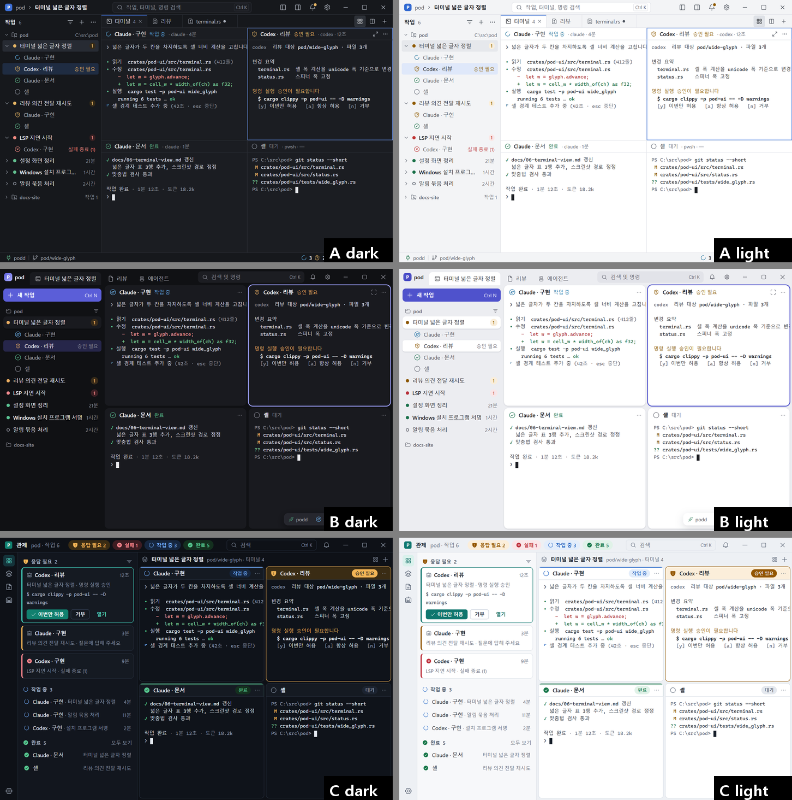
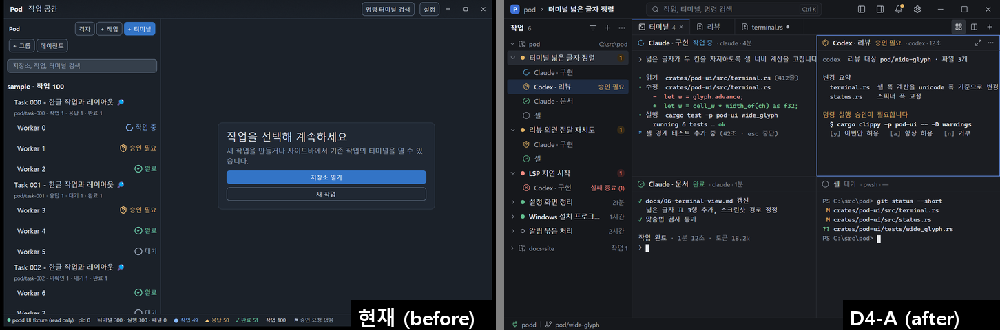

# D4 — Pod UI 다듬기: 세 방향과 권장안 (Claude 독립안)

2026-11-09 · 브랜치 `SJin-Choi/d4-claude` · 코드 변경 없음(문서와 목업만)
조사: [research.md](research.md) · 목업 소스: [src/](src/) (`python -I src/build.py`로 다시 렌더링, 로컬 Chrome만 사용) · 대비 검사: `python -I src/check_contrast.py`

## 요약

- **현재 UI가 투박한 이유는 색이 아닙니다.** 대비는 이미 통과합니다(36/36 ×2). 원인은 **밀도**(작업자 행이 40 논리 px), **크롬의 양**(테두리 텍스트 버튼 9개, 사이드바 머리 두 줄), **위계 없음**(제목, 행, 버튼 테두리가 모두 같은 무게), **기호 혼용**(▣ › ▾ ⟳ ◀ 💬 ●▲✓⚑)입니다.
- 세 방향을 만들었습니다. **A 조용한 편집기형**(얇은 선, 높은 밀도), **B 레이어형**(테두리 대신 면 단계와 둥근 패널), **C 관제형**(에이전트 상태 큐와 상태색 타일).
- **권장: A.** 여기에 C의 "응답 필요" 우선 정렬과 상태 요약을 섞습니다(§3). Pod는 터미널을 오래 띄워 두고 보는 도구입니다. 따라서 평평한 면, 1 px 선, 한 가지 강조색이 가장 오래 피로가 적습니다. GPUI에서 구현 비용이 가장 낮고, 지금 토큰과 컴포넌트 구조(`pod-ui`)를 거의 그대로 유지합니다.

## 1. 원칙 (세 방향 공통)

1. **크롬은 조용하게, 내용이 먼저.** 반복 동작은 16 px 아이콘 버튼(툴팁 + 접근성 이름 + 단축키)으로 둡니다. 텍스트 버튼은 화면당 주 동작 1–2개만 둡니다.
2. **강조색은 하나.** 포커스 링, 선택 행, 주 버튼, 활성 탭 표시에만 씁니다. 상태색(작업 중/응답 필요/완료/실패/대기)은 별도 체계로 두고, 채도를 낮추되 아이콘 모양으로도 구별합니다(v1 §4.4 유지).
3. **한 행에 한 줄.** 보조 정보는 오른쪽 메타(시간, 개수)로 두거나 hover/선택 때만 보입니다.
4. **4/8 px 격자.** 간격은 4의 배수입니다. 2 px는 아이콘과 글자 사이, 경계선 주변에만 씁니다.
5. **밀도는 모드로 나눕니다.** 기본은 컴팩트(행 28)이고 편안함(행 32)을 고를 수 있습니다. 터미널 칸 크기는 별도입니다.
6. **아이콘 한 계열, 한 굵기.** 유니코드 화살표와 이모지는 아이콘으로 쓰지 않습니다.
7. **깊이 표현은 한 가지 방식만.** A는 선, B는 면과 그림자를 씁니다. 둘을 섞지 않습니다. 그림자는 떠 있는 층(메뉴, 대화상자, 토스트)에만 둡니다.

## 2. 세 방향

| | **A 조용한 편집기형** (권장) | **B 레이어형** | **C 관제형** |
|---|---|---|---|
| 한 줄 정의 | 평평한 면 3단계 + 1 px 선, 높은 밀도 | 바깥 틀 위에 둥근 패널, 테두리 대신 면 단계 | 상태 큐와 상태색 타일, 에이전트가 주인공 |
| 밀도(100 %) | 행 28, 패널 머리 30, 탭 32, 타이틀바 36, 상태 표시줄 24 | 행 30, 카드 머리 34, 타이틀바+탭 40, 떠 있는 상태 칩 | 큐 카드 + 행 32, 타일 머리 32, 상태 표시줄 없음(요약이 타이틀바에) |
| 면/경계 | app = sidebar < panel < raised < overlay, 경계선 1 px `hairline` | app(틀)에 6 px 간격, panel 카드 반경 10, 라이트는 그림자 1단계 | app < sidebar < panel, 타일 반경 8, 상태색 윗선 2 px와 머리 배경 |
| 강조색 | 차분한 파랑 `#3D6FD6`/`#2F66D0` | 인디고 `#5B5ED8`/`#4F52CC` | 청록 `#11806F`/`#0F766E` |
| 아이콘 | **Lucide 0.468.0**(ISC, 이미 반입), 선 1.75/24 → 16 px에서 1.17 px | **Fluent UI System Icons**(MIT), regular 16/20 크기별 원본 | **Phosphor**(MIT), regular + 상태만 fill |
| 사이드바 | 머리 한 줄(제목·개수·필터·＋·…), 작업 행: 점+제목+메타, 작업자는 들여쓰기에 아이콘만 | 맨 위 "새 작업" 큰 버튼, 선택 작업만 펼침, 선택 행이 떠 있는 알약 | 좌측 레일(격자/작업/리뷰/에이전트/설정) + "응답 필요 → 작업 중 → 완료" 큐 |
| 에이전트 트리 | 열이 맞는 표형 트리(이름/프로그램/상태/경과), 꺾쇠 하나 | 카드 목록 | 큐 자체가 에이전트 뷰(별도 트리 불필요) |
| 터미널 격자 | 1 px 간격의 평면 격자, 포커스 칸은 1 px 강조 테두리 | 둥근 카드, 포커스는 2 px 링 | 둥근 타일, 상태색 머리, 승인 대기 타일은 주황 테두리 |
| 리뷰 | 분할 제어 + 아이콘 툴바, 3열(파일/diff/의견) | 같은 구조를 카드 안에 | 같은 구조 + 큐에서 바로 승인 |
| 상태 표시줄 | 묶음 3개: 연결 · 브랜치 / 상태 아이콘+수 / 터미널 수 | 오른쪽 아래에 떠 있는 상태 칩 | 없음, 타이틀바의 상태 요약 알약 |
| 강점 | 오래 봐도 조용함, 터미널 면적 최대, 구현 비용 최소, 150 %에서 선명 | 가장 "현대적"이고 부드러움, 라이트 테마가 특히 고급스러움 | 여러 에이전트를 감독하는 Pod의 정체성이 가장 분명함, 승인이 빠름 |
| 약점 | 첫인상이 평범할 수 있음 | 간격과 그림자만큼 터미널 면적이 줄어듦(약 3 %), 다크에서는 그림자 효과가 거의 없음, 카드마다 반경 클리핑 비용 | 화면이 시끄러워지기 쉬움, 상태색 면적이 커서 색약 대응과 피로 부담, 레이아웃을 크게 바꿔야 함 |
| 구현 범위 | 토큰 + 컴포넌트 다듬기(구조 유지) | 토큰 + 셸 레이아웃(간격, 반경, 탭을 타이틀바로) | 새 큐 뷰 + 레일 + 타일 머리 + 승인 동작 노출(podd API 확인 필요) |

목업(1440×960 = 960×640 논리 px @150 %, baseline과 같은 크기):

| 방향 | 다크 | 라이트 |
|---|---|---|
| A 작업 공간 | [A-quiet/dark-workspace.png](A-quiet/dark-workspace.png) | [A-quiet/light-workspace.png](A-quiet/light-workspace.png) |
| A 리뷰 | [A-quiet/dark-review.png](A-quiet/dark-review.png) | [A-quiet/light-review.png](A-quiet/light-review.png) |
| A 에이전트 | [A-quiet/dark-agents.png](A-quiet/dark-agents.png) | [A-quiet/light-agents.png](A-quiet/light-agents.png) |
| A 컴포넌트(대화상자, 배너, 버튼, 토스트, 빈 화면) | [A-quiet/dark-components.png](A-quiet/dark-components.png) | [A-quiet/light-components.png](A-quiet/light-components.png) |
| A 고대비 | [A-quiet/hc-dark-workspace.png](A-quiet/hc-dark-workspace.png) | — |
| B 작업 공간 | [B-layered/dark-workspace.png](B-layered/dark-workspace.png) | [B-layered/light-workspace.png](B-layered/light-workspace.png) |
| C 작업 공간 | [C-mission/dark-workspace.png](C-mission/dark-workspace.png) | [C-mission/light-workspace.png](C-mission/light-workspace.png) |
| 전후 비교(현재 baseline ↔ A) | [before-after/](before-after/) 작업 공간·리뷰·에이전트 × 다크·라이트 | |

B와 C의 토큰 전체는 [src/tokens.py](src/tokens.py)와 [tokens.json](tokens.json)에 있습니다. 세 방향, 여섯 테마(A는 고대비 둘 포함)의 대비 결과는 [contrast.json](contrast.json)에 있습니다(모두 통과, 테마마다 90쌍).

## 3. 권장과 근거

**A를 채택하고 C의 두 가지를 가져옵니다.**

1. **터미널이 주인공입니다.** Pod 화면의 70 % 이상이 터미널입니다. 터미널 면은 장식이 없어야 하고(Warp, Windows Terminal), 패널 사이의 간격이나 반경, 그림자(B)는 그 면적과 정렬을 깎습니다. A는 1 px 선만 씁니다.
2. **GPUI와 150 % 배율.** 1 px 경계선과 단색 면은 모든 DPI에서 선명하고 비용이 거의 없습니다. 그림자와 반경 클리핑(B), 상태색 대면적(C)은 DPI별 검증 부담이 큽니다.
3. **구조를 유지합니다.** `pod-ui` 토큰과 컴포넌트(`TreeRow`, `IconButton`, `StatusBadge`)와 앱 구조를 그대로 두고 값과 문법을 바꿉니다. 4단계, 각각 병합 가능한 크기로 나뉩니다(§6).
4. **C에서 가져올 것**: (a) 사이드바에서 **응답 필요/실패가 있는 작업에 개수 배지**를 달고, 필터 메뉴에 "응답 필요 먼저" 정렬을 둡니다. (b) 상태 표시줄 가운데에 **상태 아이콘 + 수** 요약을 둡니다(누르면 해당 상태로 필터). 큐 뷰 전체(C)는 사용자가 원하면 나중에 "에이전트" 패널의 보기 모드로 추가할 수 있습니다.
5. **B에서 가져올 것**: 떠 있는 층(메뉴, 대화상자, 토스트)에만 반경 8과 그림자를 씁니다.

## 4. 권장안 토큰 (A)

현재 `pod-ui/src/tokens.rs` 이름과의 대응을 함께 적습니다. 새 이름은 굵게 표시했습니다.

### 4.1 색 — 면, 경계, 글자

| 토큰 (현재 이름) | 다크 | 라이트 | 고대비 다크 | 고대비 라이트 | 용도 |
|---|---|---|---|---|---|
| **app** (`bg_chrome`) | `#16181C` | `#F3F4F6` | `#000000` | `#FFFFFF` | 타이틀바, 탭 막대 바탕, 상태 표시줄 |
| **sidebar** | `#16181C` | `#F3F4F6` | `#000000` | `#FFFFFF` | 사이드바(크롬과 같은 면, 경계선으로 구분) |
| **panel** (`bg_surface`/`bg_canvas`) | `#1B1D22` | `#FFFFFF` | `#000000` | `#FFFFFF` | 터미널, 리뷰, 편집기, 패널 본문 |
| **raised** (`bg_raised`) | `#22252B` | `#FFFFFF` | `#0A0A0A` | `#FFFFFF` | 메뉴, 팝오버, 의견 스레드 |
| **overlay** | `#272A31` | `#FFFFFF` | `#0A0A0A` | `#FFFFFF` | 대화상자, 토스트, 툴팁 |
| hover (`bg_hover`) | `#25282E` | `#E8EAED` | `#1F1F1F` | `#E6E6E6` | 행과 아이콘 버튼 hover |
| active (`bg_pressed`) | `#2D3138` | `#DEE1E6` | `#2B2B2B` | `#D4D4D4` | 눌림, 켜진 토글 |
| selected (`bg_selected`) | `#1F2C42` | `#DFE8FA` | `#0A2A5C` | `#CCE0FF` | 선택 행(포커스가 있을 때) |
| **selected_quiet** | `#272B33` | `#E6E8EC` | `#1F1F1F` | `#E6E6E6` | 선택된 작업의 부모 행, 포커스 밖 선택 |
| **hairline** (`border_subtle`) | `#2A2D34` | `#E1E3E8` | `#8A8A8A` | `#5A5A5A` | 영역 구분 1 px(장식, 대비 검사 제외) |
| **strong** | `#3A3F48` | `#CBD0D7` | `#FFFFFF` | `#000000` | 보조 버튼 테두리, 카드 테두리, 툴팁 |
| control (`border_control`) | `#6F7783` | `#868D98` | `#FFFFFF` | `#000000` | 입력 필드 테두리(3:1 이상) |
| **focus** | `#6A9BFF` | `#2F6BDB` | `#FFD60A` | `#0037A6` | 포커스 링 2 px, 포커스된 터미널 칸 |
| text (`text_primary`) | `#E6E8EC` | `#1C1F24` | `#FFFFFF` | `#000000` | 본문, 제목 |
| text2 (`text_secondary`) | `#AEB3BD` | `#4C525C` | `#F0F0F0` | `#141414` | 작업자 이름, 보조 라벨 |
| muted (`text_muted`) | `#8E949F` | `#5F6672` | `#D6D6D6` | `#262626` | 메타, 시간, 섹션 머리 |
| disabled | `#5C626C` | `#A2A8B1` | `#8A8A8A` | `#6E6E6E` | 비활성(대비 검사 제외) |
| accent (`action_primary_bg`) | `#3D6FD6` | `#2F66D0` | `#1A5FD0` | `#0040B0` | 주 버튼, 활성 탭 윗선 |
| accent_hover | `#3463C4` | `#2959B8` | `#2A6FE0` | `#00368F` | 주 버튼 hover(어둡게) |
| on_accent | `#FFFFFF` | `#FFFFFF` | `#FFFFFF` | `#FFFFFF` | 주 버튼 글자 |
| accent_fg (`accent_fg`) | `#8DB5FF` | `#2459BF` | `#9CC3FF` | `#0037A6` | 링크, 배너의 동작 글자 |
| term_bg / term_fg | `#1B1D22`/`#DADDE3` | `#FFFFFF`/`#23272E` | `#000000`/`#FFFFFF` | `#FFFFFF`/`#000000` | 터미널(패널과 같은 면) |

### 4.2 상태색 (차분하지만 구별됨)

| 상태 | 아이콘(Lucide) | 다크 fg / bg | 라이트 fg / bg | HC 다크 | HC 라이트 |
|---|---|---|---|---|---|
| 작업 중 | `loader-circle`(회전) | `#62B3E6` / `#1A2C38` | `#136894` / `#E3F1F8` | `#8CD3FF` | `#004E80` |
| 승인·응답 필요 | `shield-question`, `message-circle-question` | `#E5B565` / `#352A17` | `#8F5A00` / `#FBF0DC` | `#FFD45C` | `#5C3A00` |
| 완료 | `circle-check` | `#62BF8F` / `#183126` | `#1A7048` / `#E2F3EA` | `#7EE8AE` | `#00562F` |
| 실패 종료 | `octagon-x` | `#F28B82` / `#3A2022` | `#BF3434` / `#FBE7E6` | `#FF9C9C` | `#9A0010` |
| 대기 / 미확인 | `circle` / `circle-help` | = muted | = muted | = muted | = muted |
| diff 추가 / 삭제 | — | `#7DCB9B` on `#18291F` / `#F29A92` on `#33191C` | `#1C6E43` on `#E6F4EA` / `#B02E2E` on `#FCEBEA` | | |

"작업 중"은 강조색(파랑)과 겹치지 않게 하늘색 쪽으로 옮겼습니다. 강조색은 선택과 포커스만 뜻합니다.

**대비 결과**(`src/check_contrast.py`, `tools/visual/contrast.py`와 같은 WCAG 공식): A 다크, 라이트, 고대비 다크, 고대비 라이트 모두 **90/90** 통과. 글자 4.5:1 이상(고대비는 7:1 이상), 아이콘·입력 테두리·포커스 링 3:1 이상. 가장 빡빡한 쌍: 다크 muted/selected 4.60, 라이트 failed/selected 4.54, 다크 on_accent/accent 4.73, 라이트 focus/panel 4.94. 기존 `tools/visual/contrast.py`(현행 토큰)도 36/36 ×2 통과를 확인했습니다. 구현 단계 1에서 이 스크립트가 새 쌍(상태색 × 면, 배너 글자, 선택 면, 고대비 7:1)을 검사하도록 넓힙니다.

### 4.3 반경, 그림자, 간격

- 반경: 컨트롤 **4**(버튼, 입력, 행, 아이콘 버튼), 카드와 배너 **6**, 떠 있는 층(메뉴, 대화상자, 토스트) **8**, 알약과 배지 **999**. 터미널 칸은 **0**.
- 그림자(떠 있는 층만): `elevation(1)` = y 4, blur 12, 다크 `#00000040`, 라이트 `#1018281F`(메뉴, 토스트). `elevation(2)` = y 12, blur 32, 다크 `#00000066`, 라이트 `#10182824`(대화상자). 패널과 도크에는 그림자를 쓰지 않습니다(현행 원칙 유지).
- 간격: `SPACE = [0, 2, 4, 6, 8, 12, 16, 24, 32]`. 기존 배열에 6을 추가합니다. 행 안쪽 여백은 8, 아이콘과 글자 사이는 6–8.

### 4.4 글자

Segoe UI Variable Text → Segoe UI → Malgun Gothic(한글) / Cascadia Mono → Consolas(코드). 100 % 기준 논리 px입니다.

| 역할 | 크기/줄 높이/굵기 | 쓰임 |
|---|---|---|
| caption | 12 / 16 / 400 | 메타, 상태 표시줄, 배지(11/16/600은 개수 배지에만) |
| body | **13 / 20 / 400** | 기본 UI 글자 |
| label | 13 / 20 / 500 | 작업 제목, 탭, 패널 머리 이름 |
| strong | 13 / 20 / 600 | 섹션 머리, 강조 수치 |
| title | 15 / 22 / 600 | 대화상자와 빈 화면 제목(기존 15/24에서 줄 높이를 줄임) |
| display | 20 / 28 / 600 | 설정 페이지 제목만 |
| code | 12 / 18 (터미널은 설정값), diff 12 / 20 | 터미널, diff |

현재 TYPE의 28/36은 쓰지 않습니다. 빈 화면 제목도 15로 둡니다.

### 4.5 높이와 아이콘 격자 (100 %, 컴팩트 / 편안함)

| 요소 | 컴팩트 | 편안함 |
|---|---|---|
| 타이틀바 | 36 | 40 |
| 탭 막대 | 32 | 36 |
| 패널 머리(터미널 칸, 리뷰 툴바는 36) | 30 | 34 |
| 사이드바 작업 행, 작업자 행, 에이전트 행 | **28** | **32** |
| 섹션 머리 | 26 | 28 |
| 상태 표시줄 | 24 | 26 |
| 아이콘 버튼(hit) | 28(툴바 안 24–26, 시각 크기만 줄이고 hit 24 이상) | 32 |
| 입력·버튼 | 28(대화상자 입력 30) | 32 |

아이콘: **16**(기본), **14**(행 안의 상태 아이콘, 상태 표시줄, 배너), **12**(꺾쇠, 탭 닫기), **20**(빈 화면). 선 굵기는 24 그리드 기준 **1.75**로, 16 px에서 1.17 px이 되어 13 px 한글 획과 맞습니다. 현재는 2이고 1.33 px입니다. 아이콘 색은 기본 text2, hover·켜짐은 text, 상태는 상태색입니다.

## 5. 아이콘 세트

**Lucide를 유지하고 0.468.0으로 고정합니다**(ISC + Feather 유래 MIT, `crates/pod-ui/THIRD-PARTY.md`에 이미 있음, [lucide.dev/license](https://lucide.dev/license)에서 다시 확인). 아래 이름이 모두 0.468.0에 있는 것을 받아서 확인했습니다(`src/fetch_icons.py`). 빌드 때 `stroke-width`를 1.75로 바꾼 사본을 `pod-ui/assets/icons`에 둡니다. 모든 이모지와 유니코드 기호를 바꿉니다.

| 용도 | Lucide 이름 | 바꿀 대상 |
|---|---|---|
| 검색 / 명령 | `search`, `command` | 타이틀바 "명령·터미널 검색" 텍스트 버튼 |
| 새로 만들기 | `plus` | "+ 작업", "+ 터미널", "+ 그룹" → ＋ 하나와 메뉴 |
| 격자 보기 / 나란히 | `layout-grid`, `columns-2`, `rows-2` | "격자" 텍스트 버튼, 리뷰 "나란히/한 줄로" |
| 에이전트 | `bot` | "에이전트" 텍스트 버튼 |
| 패널 열고 닫기 | `panel-left`, `panel-right` | (새로 추가) |
| 설정 / 알림 | `settings`, `bell` | "설정", "알림 0" 텍스트 버튼 |
| 트리 | `chevron-right`, `chevron-down` | ▸ ▾ 열, 이름 앞 `› ` |
| 작업 / 그룹 / 터미널 노드 | `layers`, `folder-git-2`, `square-terminal` | ▣ |
| 더 보기 / 닫기 / 최대화 | `ellipsis`, `x`, `maximize-2` | `…` 글리프 |
| 리뷰 이동 | `arrow-up`, `arrow-down`, `chevron-left`, `chevron-right` | ↑ ↓ ◀ ▶ |
| 다시 읽기 | `rotate-cw` | ⟳(review, gates, "⟳ 비교") |
| 줄바꿈 / 펼치기 | `wrap-text`, `unfold-vertical` | "줄바꿈", "펼치기" 텍스트 토글 |
| 파일 / diff / PR / 브랜치 | `file-diff`, `git-pull-request`, `git-branch` | — |
| 의견 / 보내기 / 확인 | `message-square`, `send`, `check` | 💬, `파일 ✓`·`의견 ✓`의 ✓, PR "✓ 병합됨" |
| 필터 | `list-filter` | 사이드바 검색칸(필요할 때만 펼침) |
| 연결 | `plug`, `unplug`, `wifi-off` | 상태 표시줄 "podd …" 앞 ● |
| 상태 | `loader-circle`, `shield-question`, `message-circle-question`, `circle-check`, `circle`, `circle-help`, `triangle-alert`, `octagon-x`, `lock-keyhole` | 상태 표시줄 ● ▲ ✓ ⚑ |
| 창 캡션 | `minus`, `square`, `x`(복원은 `copy`) | (OS 의미와 hit-test 유지) |
| 빈 화면 / 기타 | `folder-open`, `keyboard`, `eye`, `sun`, `moon`, `monitor` | — |

`🔎`는 픽스처 작업 이름(이모지 렌더 시험)이므로 그대로 둡니다. 아이콘을 바꾸는 대상이 아닙니다.

B를 고르면 Fluent UI System Icons(MIT, 크기별로 그린 16/20 원본이 있어 작은 크기에서 가장 또렷함), C를 고르면 Phosphor(MIT, regular/fill 쌍으로 상태를 강조)가 맞습니다. 두 계열 모두 같은 이름 목록이 있는 것을 확인했습니다([src/fetch_icons.py](src/fetch_icons.py)의 대응표). Codicons는 아이콘이 CC-BY-4.0이라 제외했습니다.

## 6. 컴포넌트 명세 (A)

### 타이틀바 (36)
- 왼쪽: 앱 아이콘 18 → 경로 `pod › 터미널 넓은 글자 정렬`(저장소는 muted, 현재 작업 또는 화면은 text 600). **"Pod" 글자는 쓰지 않습니다.** 창 제목(OS)에만 `작업 이름 — Pod`.
- 가운데: 명령 알약 340×26, 반경 6, 면 panel, 경계 hairline, `search` 14 + `작업, 터미널, 명령 검색` muted + 오른쪽 `Ctrl K` kbd. 누르면 기존 팔레트(Ctrl+K)를 엽니다. 창이 좁으면 아이콘만 남깁니다.
- 오른쪽: 아이콘 버튼 28: `panel-left`(사이드바), `panel-right`(에이전트), `bell`(읽지 않은 응답 필요가 있으면 주황 점 7 px), `settings`. 그다음 캡션 46×36.
- 툴팁: `이름 + 단축키`. 접근성 이름은 기존 문자열을 유지합니다.

### 사이드바 (폭 248, 최소 216, 최대 360)
- **머리 한 줄(36)**: `작업` 13/600 + 개수 muted + 오른쪽 아이콘 버튼 26: `list-filter`(검색칸 토글, Ctrl+Shift+F), `plus`(메뉴: 새 작업 Ctrl+N / 새 터미널 Ctrl+Shift+T / 새 그룹), `ellipsis`(정렬: 최근·이름·응답 필요 먼저, 모두 접기). 격자 전환은 탭 막대로, 에이전트는 타이틀바로 옮깁니다.
- **저장소 섹션 머리(26)**: 꺾쇠 12 + `folder-git-2` 14 + 이름 12/600 muted + 오른쪽 경로 muted(좁으면 숨김).
- **작업 행(28)**: 꺾쇠 14(hover나 펼침일 때만 진하게) · 상태 점 8(작업자 중 가장 급한 상태: 실패 > 응답 필요 > 작업 중 > 대기 > 완료. 대기는 속이 빈 원) · 제목 13/500 말줄임 · 오른쪽에 응답 필요나 실패 수가 있으면 상태색 배지(11/600, 상태 bg), 없으면 최근 활동 시간 muted 12. 브랜치와 상태 집계는 툴팁과 hover 카드로 옮깁니다(현재 두 번째 줄 삭제).
- **작업자 행(28, 들여쓰기 30)**: 상태 아이콘 14(상태색) + 이름 13/400 text2. **상태 글자는 hover, 선택, 실패일 때만** 오른쪽에 상태색으로 보입니다. 접근성 이름은 항상 `이름 · 상태`.
- 상태: hover = hover 면, 선택(포커스 있음) = selected 면 + text, 선택(포커스 없음) = selected_quiet, 선택 작업의 부모 행 = selected_quiet, 키보드 포커스 = 2 px focus 링(안쪽 2 px offset, 반경 4). 행은 좌우 6 px 안쪽에 반경 4로 떠 있습니다.
- 행 사이 간격은 0이고, 섹션 사이는 6입니다.

### 에이전트 트리 (오른쪽 도크, 폭 400–480)
- 머리(32): `bot` + `에이전트` 600 + `실행 7 · 확인 필요 2` muted + `list-filter`, `x`.
- 열 머리(26, 11/600 muted): 이름 | 프로그램(64) | 상태(92) | 경과(40, 오른쪽 정렬). 모든 행이 같은 열 격자를 씁니다.
- 작업 행: **꺾쇠 하나** + `layers` 14 + 이름 500 | `작업 4` | 점 + 집계 | 시간. 작업자 행: 들여쓰기 34 + `square-terminal` 14 + 이름 | 프로그램 이름(mono 11 muted) | 상태 아이콘 + 상태 글자 | 경과. **두 번째 줄(`powershell · fixture-0`)은 툴팁으로 옮깁니다.**
- 이름 앞의 `› `와 ▸/▾ 열을 없앱니다. 접근성 이름은 지금처럼 `터미널 이름 · 상세`를 유지합니다.
- 오류는 패널 위 인라인 배너로 보여 줍니다(아래 배너 규칙).

### 탭 막대와 도크·패널 머리
- 탭 막대 32: 면 app. 탭은 아이콘 14 + 이름 13 + (개수 muted 또는 수정 점 6) + 닫기 `x` 12(활성이나 hover 때만). 활성 탭은 면 panel + 윗선 2 px accent이고 아랫선이 없습니다(내용과 이어짐). 비활성 탭 사이는 hairline.
- 탭 막대 오른쪽: 보기 전환 `layout-grid`/`columns-2`(격자/나란히), `plus`(새 터미널).
- **편집기 탭 작업과의 조율**: 파일별 독립 탭(docs/09 §13 설계 메모) 작업이 탭 동작(고정, 미리보기, 순서)을 맡습니다. D4는 **수치와 토큰만**(높이 32, 패딩 10/12, 활성 표시, 수정 점, 닫기 버튼 노출 규칙) 정합니다. 같은 `TabStrip` 컴포넌트를 공유합니다.
- 터미널 칸 머리 30: 상태 아이콘 14 + 이름 13/500 + 상태 글자(상태색 12) + `· 프로그램 · 경과` muted 12. 오른쪽 `maximize-2`, `ellipsis`는 hover/포커스 때만 보입니다. 브랜치는 반복하지 않습니다(경로 표시와 탭에 이미 있음).
- 칸 사이는 1 px hairline이고, 포커스된 칸은 안쪽 1 px focus 테두리입니다.

### 리뷰
- 탭 아래 머리 36: `git-branch` + `pod/wide-glyph → main` + `파일 3 · +85 −7`(mono 12, diff색) · 오른쪽: **분할 제어** `[columns-2 나란히 | rows-2 한 줄로]`(26, 반경 5, 면 app, 켜진 쪽 raised + strong 테두리) · 구분선 · 아이콘 토글 `wrap-text`, `unfold-vertical`(켜짐 = active 면) · 구분선 · `arrow-up` `arrow-down`(변경 이동, Shift+F7/F7) `chevron-left` `chevron-right`(파일 이동) · 구분선 · `rotate-cw`(F5), `ellipsis`(파일 ✓, 의견 ✓ 표시 옵션을 메뉴로 옮김).
- 3열: 파일 목록 220(행 28 + 둘째 줄 +/− mono 11) | diff(줄 번호 11 muted, 행 20, 추가·삭제 면, hunk 머리 app 면) | 의견 280. 리뷰 화면에서는 사이드바를 자동으로 접고 `panel-left`로 다시 열 수 있습니다(목업 참고).
- 인라인 의견 스레드: raised 면, strong 테두리, 반경 6, **왼쪽 3 px 상태색 안쪽 선**(미해결 = attention). 제목 줄: 아바타 20 + 작성자 + `2분 전 · 216행` muted + `미해결` 배지.
- 의견 칸: 머리 32 `message-square` `의견` + `미해결 1 · 전체 2` · 카드(반경 6, 열린 것은 strong 테두리) · 아래쪽에 정보 배너 → 요청 입력(control 테두리, **줄바꿈 허용, 오른쪽 잘림 금지**) → `받는 에이전트` + 주 버튼 `send 미해결 1개 보내기`.
- 오류(`변경 사항을 읽지 못했습니다`)는 본문의 빨간 글자가 아니라 diff 영역 위 **인라인 오류 배너**로 보여 주고 `다시 시도`(F5) 동작을 붙입니다.

### 배너, 토스트, 대화상자, 빈 화면
- **배너**(인라인, 반경 6, 여백 8/10, 12/18): 상태 bg 면 + 상태색 아이콘 14 + text 문장 + 오른쪽 동작 링크(accent_fg 600). 종류: 오류(`triangle-alert`), 승인 대기(`shield-question`), 정보(`plug`/`loader-circle`). 빨간 글자만 쓰는 오류 표시는 금지합니다.
- **토스트**: overlay, strong 테두리, 반경 8, elevation 1, 폭 360. 아이콘 16 + 제목 13/600 + 설명 12/18 text2 + `열기` + `x`. 시간과 개수 규칙은 v1 §5.4를 유지합니다.
- **대화상자**: overlay, 반경 8, elevation 2, 여백 16, 필드 사이 12. 라벨 11/600 muted, 입력 30. 프로그램 선택은 **분할 제어**(`square-terminal 셸 | bot Claude | bot Codex | 사용자 지정`). 버튼은 오른쪽 정렬 `취소`(보조) `실행 Enter`(주).
- **빈 화면**: 아이콘 타일 40(반경 8, app 면, 아이콘 20) + 제목 15/600 + 설명 13 text2(최대 폭 300, 문장 단위 줄바꿈) + 주 버튼 하나와 보조 고스트 버튼 하나(단축키 kbd). 경우마다 다른 문구를 씁니다(v1 §5.5). 지금처럼 같은 폭의 두 버튼을 세로로 쌓지 않습니다.

### 상태 표시줄 (24)
`[plug podd] | [git-branch 현재 브랜치] ……… [loader 3  shield 2  octagon-x 1  circle-check 5] | [square-terminal 터미널 12]`
- 묶음 사이는 1×12 strong 구분선입니다. 수치는 600 text, 아이콘은 상태색 14입니다. 각 묶음은 툴팁과 클릭 동작을 가집니다(상태 아이콘 = 해당 상태 필터, 연결 = 연결 상세).
- `podd UI fixture (read only) · pid 0` 같은 진단 정보는 연결 묶음의 툴팁과 `상태` 인스펙터로 옮깁니다. `상태`, `알림` 텍스트 버튼은 없앱니다(알림은 타이틀바 `bell`). "승인 요청 없음" 같은 0 상태 문구는 보이지 않게 합니다.

### 아이콘 버튼과 포커스
- 28×28(툴바 안 24–26), 반경 4, 아이콘 16 text2 → hover: hover 면 + text → 켜짐: active 면 + text → 포커스: 2 px focus 링. 모든 아이콘 버튼에 접근성 이름 = 툴팁 문구(기존 `IconButton` 계약).

### 설정 화면
- 왼쪽 목록 200(행 28, 아이콘 16 + 이름: 일반, 모양, 터미널, 에이전트, 단축키, 연결, 확장, 정보) | 본문 최대 폭 640, 왼쪽 정렬, 위 여백 24.
- 본문: 페이지 제목 20/28 → 그룹 제목 13/600 + 설명 12 muted → 설정 행(최소 40): 왼쪽 라벨 13 + 설명 12 muted, 오른쪽 컨트롤(토글, 분할 제어, 드롭다운 28). 그룹 사이는 hairline + 24.
- "모양"에 테마(시스템/다크/라이트/고대비), **밀도(컴팩트/편안함)**, UI 글자 크기(12–15), 움직임 줄이기(시스템 따름)를 둡니다.

## 7. 움직임

- hover 면 전환 **100 ms**, 눌림 즉시, 펼치기와 접기(트리, 메뉴) **150 ms** ease-out(`EASING_ENTER`), 토스트 등장 150 ms(위로 4 px + 불투명도), 대화상자 150 ms 불투명도만. 기존 `MOTION_MS [0,100,160,220]`를 `[0,100,150,200]`으로 줄입니다.
- 작업 중 스피너는 1 s 회전(현행 `ACTIVITY_MS`)을 유지합니다. **움직임 줄이기**(OS 설정 또는 앱 설정)일 때는 모든 전환이 0이고, 스피너는 정지한 `loader-circle` + "작업 중" 글자로 바꿉니다. 시각 회귀 캡처는 지금처럼 reduced motion으로 찍습니다.
- 레이아웃 크기를 애니메이션하지 않습니다(사이드바 폭, 격자 재배치). 터미널 재흐름 비용 때문입니다.

## 8. 구현 계획 (병합 가능한 4단계)

공통 수용 기준(모든 단계):
1. `tools/visual/capture.ps1 -Mode compare` 실패 장면을 **모두 눈으로 검토한 뒤** baseline을 갱신하고, PNG, UIA 트리, manifest를 같이 커밋합니다.
2. `tools/visual/contrast.py` 통과. 단계 1에서 새 쌍과 고대비 7:1을 검사하도록 확장합니다.
3. **접근성 이름 불변**: 바꾸기 전후 `*.tree.txt`의 이름 목록 diff가 의도한 변경(예: 없어진 텍스트 버튼 → 같은 이름의 아이콘 버튼)뿐이어야 합니다. 이름 문자열은 `strings.rs`의 기존 상수를 재사용합니다.
4. DPI 100/125/150/175 % 검사(`mixed-dpi.ps1`과 해당 배율 캡처). 1 px 선이 흐려지거나 사라지지 않고, 아이콘이 장치 픽셀에 맞아야 합니다.
5. **한국어 잘림 없음**: 긴 작업 이름, 긴 상태(`실패 종료 (127)`), 좁은 창(1024×700 매트릭스)에서 말줄임과 툴팁이 맞게 동작하고 고정 폭 라벨이 잘리지 않아야 합니다.
6. `cargo test --workspace` 통과, 키보드만으로 모든 새 아이콘 버튼과 분할 제어에 도달하고 조작할 수 있어야 합니다.

| 단계 | 범위 | 파일(주로) | 추가 수용 기준 |
|---|---|---|---|
| **1. 토큰과 아이콘** | §4 색(다크, 라이트, 고대비 재정의. 고대비가 지금처럼 일부만 덮어쓰지 않도록 완전한 세트로), 반경, 간격 6, TYPE 표, 높이 표, 밀도 설정(컴팩트/편안함), 움직임 값. Lucide 0.468.0에서 §5의 아이콘 추가와 선 1.75 사본, THIRD-PARTY 갱신 | `pod-ui/src/tokens.rs`, `components.rs`, `assets/icons/`, `THIRD-PARTY.md`, `tools/visual/contrast.py` | 대비 스크립트 확장 통과, 아이콘이 모두 `include_bytes`로 묶여 런타임 다운로드가 없음, 고대비 캡처 |
| **2. 셸 크롬** | 타이틀바(경로, 명령 알약, 아이콘 버튼, "Pod" 중복 제거), 상태 표시줄 묶음, 탭 막대 수치(편집기 탭 작업과 같은 컴포넌트), 터미널 칸 머리, 포커스 칸 표시 | `pod-app/src/chrome.rs`, `workspace.rs`, `layout.rs`, `panel.rs` | 타이틀바 드래그와 캡션 hit-test 불변(native QA), 좁은 창에서 알약이 아이콘으로 접힘, 상태 표시줄 각 묶음의 툴팁과 접근성 이름 |
| **3. 사이드바와 에이전트 트리** | 한 줄 머리 + ＋ 메뉴 + 필터 토글, 작업/작업자 행 문법, 개수 배지, "응답 필요 먼저" 정렬, 에이전트 표형 트리(꺾쇠 하나, 열, `› `/▸▾/▣ 제거, 두 번째 줄을 툴팁으로) | `tree.rs`, `groups.rs`, `vm.rs`(표시 필드만), `strings.rs` | 행 높이 28/32 측정(150 %에서 42/48 px), 100개 작업 픽스처에서 스크롤 성능 불변, 기존 키보드 트리 탐색(←/→/↑/↓/Enter) 불변 |
| **4. 리뷰와 상태 화면** | 분할 제어와 아이콘 툴바(↑↓◀▶⟳ 제거), 💬 → `message-square`, 의견 칸 줄바꿈 수정, 오류/경고/정보 배너 컴포넌트, 빈 화면, 토스트, 대화상자의 분할 제어, 설정 레이아웃과 밀도 옵션, gates/PR의 ⟳·✓ | `review.rs`, `gates.rs`, `pr_panel.rs`, `orch.rs`, `pod-ui/components.rs` | 리뷰 단축키(F7/Shift+F7/Alt+PgUp/PgDn/F5) 불변, 의견 칸이 280 폭과 175 %에서 잘리지 않음, 배너 동작이 키보드로 도달 가능 |

단계 1은 단독으로 병합해도 화면이 깨지지 않습니다(값만 바뀜). 2–4는 서로 파일이 거의 겹치지 않아 병렬로 진행할 수 있습니다(공통 컴포넌트는 1에서 먼저 넣음). 디자인 작업 배정 원칙(디자인은 Codex Astra)에 따라 구현 담당은 코디네이터가 정합니다.

## 9. 열린 질문

- 사용자가 B나 C의 인상을 더 원하면: A 토큰 위에 **B의 라이트 테마 처리**(app `#ECEDF1` 틀 + 흰 패널 카드)만 "라이트 레이어" 옵션으로 얹을 수 있습니다. 토큰만 바꾸고 레이아웃 간격 6 px만 추가하면 됩니다.
- C의 큐에서 바로 승인(`이번만 허용/거부`)하려면 podd에 승인 응답 API가 있어야 합니다. 현재 hook 경로로 가능한지 확인이 필요합니다(이번 범위 밖).
- Segoe UI Variable의 광학 크기(opsz)는 GPUI에서 지정할 수 없을 수 있습니다. 13 px에서는 Text 변형이 기본이라 영향은 작습니다.
